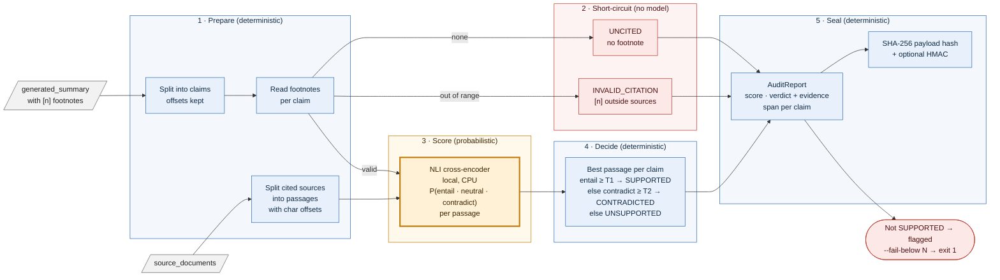

# rag-audit — a factuality gate for AI-written summaries, checked sentence by sentence against the cited source

**Status: v0.1, portfolio project.** Core library, CLI and tests are complete; the NLI gate is benchmarked on FEVER ([Results](#results)). Not yet done: HaluEval, a PyPI release, multi-claim and non-Wikipedia evaluation. Every known gap is in [Limitations](#limitations).

```text
factuality score: 40%  (2/5)
  SUPPORTED         The Harbor Bridge opened in 1932 [1].            source 1 chars 0-44
  CONTRADICTED      It carries eight lanes of traffic [1].           source 1 chars 45-111
  SUPPORTED         The ferry service ended in 1960 [2].             source 2 chars 0-39
  UNCITED           The bridge was designed by a famous architect.
  INVALID_CITATION  The ferry was replaced by a tunnel in 1975 [3].
payload sha256: a27614165856cb273e6a5b1695a75577a5a672ea6d6302604dc542f46776e15d
```

*Real output of [examples/demo.py](examples/demo.py) with the real `nli-deberta-v3-small` model (spacing tidied). A five-sentence summary with footnotes goes in; each sentence comes out with a verdict and, where it was checked, the exact character range of the source sentence it was checked against.*

## What is this? (plain-language overview)

AI assistants now write summaries, briefings and answers from documents they were given, and they add footnotes like `[1]` that look like proof. The footnotes are part of the generated text. A model can write `[1]` after a sentence the source never said, cite a document that does not exist, or flip a number, and the result reads just as confidently as a correct one. Most people check this by skimming, which does not scale.

rag-audit is a small Python library and command-line tool that does the checking. You give it the source documents and the AI-written summary. It then:

1. **Splits** the summary into sentences and reads which footnotes each sentence carries.
2. **Finds** the cited source and the single sentence in it that best matches the claim, and records exactly where that sentence sits (character offsets), so a human can click straight to it.
3. **Asks a small, local language-inference model** whether that source sentence *entails*, is *neutral to*, or *contradicts* the claim.
4. **Decides with fixed rules.** A threshold turns the probabilities into a verdict. A sentence with no footnote, or a footnote pointing at a document that was not supplied, is flagged without asking any model.
5. **Seals the result.** The report carries a SHA-256 hash of the sources, the summary, the thresholds and every verdict, and can carry an HMAC signature, so a later reader can tell whether anything changed.

**What it is not.** It does not decide what is *true*, only whether the *cited source supports the sentence*. It does not fetch documents, call a hosted LLM, or rewrite anything. Everything runs offline on a CPU.

### Who it is for, and when it earns its place

| If you are... | rag-audit gives you... |
| --- | --- |
| building a RAG or briefing product | a pre-publish gate: block or flag an answer whose citations do not hold up, before a user sees it |
| evaluating an LLM or a prompt | a repeatable, non-LLM score for "does the output stay inside its sources", usable in CI |
| an analyst or editor reviewing AI drafts | a short list of the sentences to look at, each with its source passage located |
| working somewhere that cannot send documents to a hosted model | a checker that runs entirely on a local machine |

It is a poor fit if your summaries carry no citations (every sentence is flagged `UNCITED` by design), if claims need several sources combined, or if you need a verdict on real-world truth rather than on source support.

### Why not just ask another LLM to judge?

An LLM judge is itself a generator: it can be fooled by fluent text, differs from run to run, costs money per call, and tends to share the biases of the model it grades. Here the model only produces three probabilities for one (passage, claim) pair; **everything that decides, flags or hashes is ordinary deterministic code** with unit and property-based tests. The same inputs give the same report and the same hash.

**What's real and what's not.** The library, the CLI and the benchmark are real and runnable. The benchmark is on FEVER (Wikipedia claims), not on your documents, and the quoted numbers say nothing about other domains until you measure them there. `LexicalOverlapNLI` in the code is a word-overlap *test double* used so the logic can be unit-tested without model weights; it is not a verifier.

## At a glance

| | |
| --- | --- |
| Input | a list of source texts, and a summary with `[n]` footnotes |
| Output | an `AuditReport`: score 0-100, a verdict and evidence span per sentence, flagged list, SHA-256 hash, optional HMAC |
| Model | `cross-encoder/nli-deberta-v3-small` (Hugging Face), about 570 MB, CPU is enough |
| Speed | 45 ms per claim at the median on CPU (small model, FEVER-sized evidence) |
| Measured quality | F1 0.92 flagging unsupported claims on FEVER, keeping 82.5% of supported ones, when passages carry their title ([Results](#results)) |
| Tests | 10, including property-based; `mypy --strict`; ruff |
| Interfaces | Python API, `rag-audit` CLI (exit code 1 below a score you choose), Docker |

## Architecture at a glance



*Blue is plain deterministic code; the single amber box is the only place a model is involved, and all it returns is three probabilities per passage. Red marks outcomes that flag a claim without any model call, or flag it after one. `T1` is `entail_threshold` and `T2` is `contradict_threshold`. Every verdict, flag, hash and signature comes from the blue code around the model.*

## Quickstart

```bash
git clone https://github.com/PCSchmidt/rag-audit && cd rag-audit
uv venv && uv pip install -e ".[nli,dev]"        # [nli] pulls torch + transformers

python examples/demo.py                         # the output shown above (first run downloads the model)
rag-audit --sources doc1.txt doc2.txt --summary summary.txt --fail-below 80 > report.json
pytest -q                                       # 10 passed, no model download needed
```

```python
from rag_audit import FactualityAuditor
from rag_audit.nli import CrossEncoderNLI

report = FactualityAuditor(CrossEncoderNLI(), entail_threshold=0.55,
                           signing_key=b"my-secret").audit(sources, summary)
report.factuality_score      # 40.0
report.flagged               # the claims to look at
report.payload_sha256        # same inputs -> same hash
```

Set `RAG_AUDIT_SIGNING_KEY` to sign CLI reports. Offline container: `docker build -t rag-audit . && docker run --rm --network none rag-audit` (runs the tests).

**Give passages their context.** The model sees one source sentence at a time. If that sentence says "He was born in 1950", it cannot know who "He" is. In the FEVER benchmark, prefixing each evidence sentence with its page title (`"Title: sentence"`) lifted the share of supported claims kept from 56.5% to 82.5%. The library does not add context for you.

## Approach: why it is built this way

- **Separate deciding from guessing.** The NLI model is probabilistic; the verdict, the flag and the hash are not. This is the whole design, and it is what makes the output auditable.
- **Locate, don't just score.** A verdict you cannot trace is a verdict you cannot trust. Every checked claim carries the source index and the character range of its best passage.
- **Fail toward flagging.** Uncited, mis-cited, un-entailed: all flagged. The cost is review time on false flags; the benefit is that nothing unverified is silently passed.
- **Small and local.** A 570 MB model on CPU keeps cost near zero and lets it run where documents cannot leave the machine.
- **Measure before claiming.** Thresholds are frozen on a development split before the test split is scored, and a run that turned out invalid stays in the repo ([Results](#results)).

## Motivation

This is the standalone form of a rule from my other projects: *check for fabrication before publish*. Hard Power Intelligence runs an evaluator over its briefings, and VERA audits research papers for unsupported claims. rag-audit pulls the core of that idea into a small, pip-installable library with an NLI model instead of an LLM judge, so any RAG pipeline can use it. It is deliberately narrower than those projects: it checks citation support only.

## Method (what the library actually does)

1. **Claim splitting** (`claims.py`). Sentence boundary regex that keeps `[n]` markers with their sentence, including `fact.[1]`, `fact [1].` and `fact. [1]`. Each claim keeps its character offsets in the summary.
2. **Passage splitting** (`auditor.passages`). Each cited source is cut into sentences with offsets back into the original text.
3. **NLI scoring** (`nli.CrossEncoderNLI`). For each cited passage, the model gives probabilities over entailment, neutral and contradiction. Label order is read from the model config and validated, never assumed.
4. **Verdicts** (`auditor.FactualityAuditor`):

| Verdict | Meaning |
| --- | --- |
| SUPPORTED | a cited passage has entailment at or above `entail_threshold` |
| CONTRADICTED | not supported, and a cited passage has contradiction at or above `contradict_threshold` |
| UNSUPPORTED | cited, but nothing entails it |
| UNCITED | the sentence carries no footnote |
| INVALID_CITATION | a footnote number is outside the supplied sources |

5. **Report.** Score = supported claims / all claims x 100. The payload hash covers SHA-256 of each source and of the summary, the model name, both thresholds, and each claim's text, verdict, rounded entailment and evidence span. An optional HMAC-SHA256 over that hash lets a holder of the key verify it with `verify_signature`.

## Results

Dataset: FEVER (`copenlu/fever_gold_evidence`). 600 claims per label (supports, refutes, not-enough-info); a claim is cited to its evidence, and the gate should keep SUPPORTS and flag the rest. Thresholds were frozen on a development split per condition, then each condition ran once on the same 1,800 held-out test items.

| Model | Passages carry page title | F1 (flagging unsupported) | Precision | Recall | Supported claims kept | Median latency |
| --- | --- | --- | --- | --- | --- | --- |
| small | no | 0.874 | 0.813 | 0.946 | 56.5% | 44 ms |
| **small** | **yes** | **0.920** | 0.914 | 0.927 | **82.5%** | 46 ms |
| base | no | 0.890 | 0.842 | 0.945 | 64.5% | 88 ms |
| base | yes | 0.933 | 0.934 | 0.932 | 86.8% | 95 ms |

- Missing context, not model size, caused most of the false flags: adding titles moved retention by 22-26 points; moving from small to base without titles moved it by 8.
- Small plus titles is the best measured cost/quality point; its F1 gap to base plus titles (0.013) is within noise.
- Catch rate for unsupported claims stayed at 0.93-0.95 in every condition.
- The raw entailment probability is overconfident (ECE 0.08-0.17); do not present it as a calibrated probability.

Full tables, protocol, the rejected hypothesis, and an invalid first run that is kept on purpose: [docs/RESULTS.md](docs/RESULTS.md).

## Limitations

- **One domain measured.** FEVER is Wikipedia sentences and short claims. Performance on long reports, tables, legal or technical text, or non-English text is unknown.
- **One claim, one passage.** A claim that needs two sentences, or two documents, combined is scored against each passage separately and may be marked UNSUPPORTED. Claim splitting is sentence-level; one sentence containing two facts gets one verdict.
- **Context is the caller's job.** See the title-prefix finding above. Pronouns and implicit subjects are not resolved.
- **Support, not truth.** A claim that matches a wrong source is SUPPORTED.
- **Probabilities are not calibrated.** Thresholds were chosen on FEVER and the dev curve is nearly flat, so no threshold is an optimum; re-pick yours on your own data.
- **Token limit.** The model truncates a (passage, claim) pair at 512 tokens.
- **Not adversarial.** Paraphrased, negated or deliberately misleading claims were not specifically tested.
- **No release yet.** Not on PyPI; HaluEval, GPU timings and larger-model comparisons are not run. The `roberta-large-snli_mnli_fever_anli` model named in my plan was skipped on purpose: it was trained on FEVER, which would contaminate this benchmark.

## Operational notes

### What runs where

Everything runs locally. Only the first run touches the network, to download the model from Hugging Face. After that the audit makes no network calls (the container recipe uses `--network none`).

### Data and keys

No keys are needed. `RAG_AUDIT_SIGNING_KEY` is optional and only signs the report. The benchmark uses the public FEVER dataset; no private or sensitive data is involved.

### Verify the claims (a reviewer's path)

```bash
pytest -q                                                    # 10 passed
mypy src tests scripts                                       # strict, clean
python examples/demo.py                                      # the verdicts shown at the top
bash scripts/run_ablation.sh                                 # the 2 x 2 FEVER table (needs `datasets`; slow on CPU)
python -c "import json;print(json.load(open('results/ablation/small_titles/test_summary.json')))"   # raw numbers
```

Raw per-item scores for every table row are committed under `results/`.

### Documentation map

| Doc | What it covers |
| --- | --- |
| [docs/RESULTS.md](docs/RESULTS.md) | protocol, the 2 x 2 ablation, an earlier baseline, the invalid first run, what was not measured |
| [examples/demo.py](examples/demo.py) | the worked example at the top |
| [scripts/fever_benchmark.py](scripts/fever_benchmark.py), [scripts/run_ablation.sh](scripts/run_ablation.sh) | the benchmark and its driver |
| [results/](results/) | frozen thresholds and per-item scores behind every number |

## License

MIT. See [LICENSE](LICENSE). FEVER data is used under its own terms (CC BY-SA).

## Author

Chris Schmidt ([PCSchmidt](https://github.com/PCSchmidt)). Part of a portfolio on evaluator-gated AI systems: probabilistic components propose, deterministic gates decide.
