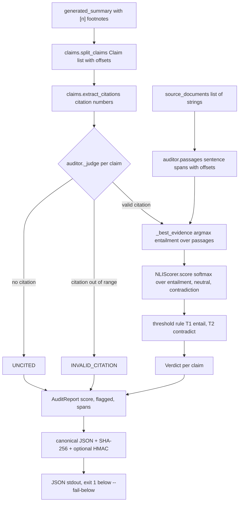
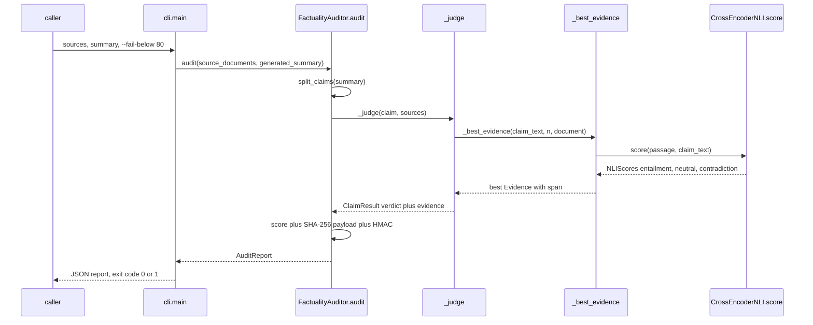

# rag-audit — Master Explainer

Repo: <https://github.com/PCSchmidt/rag-audit> · License: MIT · Last commit: 2026-10-13 (`14db891`) · Tag: `v0.2.0`
Status: v0.2.0 portfolio study — core library, CLI and tests complete; NLI gate benchmarked on FEVER; not on PyPI; HaluEval not run [Documented] README · active burst 2026-10-09 → 2026-10-13 (11 commits); paused or done [Unknown]
Explainer generated: 2026-10-18 by an AI agent under Chris Schmidt's direction · Questionnaire v1.2 · Depth: LITE (LITE run)

LITE-run assembly note: one session, read-only inspection; §9 reuses this run's earlier math pass (`rag-audit.math.md`), re-verified against the repository. VERA pass files in the run brief concern another repository.

> Tags: **[Verified]** seen in code/config/tests/commits (cite `path:line`, function, SHA); **[Documented]** stated in a committed doc; **[Author]** confirmed `AUTHOR_CONTEXT.md` ANSWER line (⚠ = [Inferred]); **[Inferred]** reasoned (rest-on stated); **[Proposed]** not in the repo; **[Unknown]** → §26. **No execution this run:** nothing [Measured]; repo numbers are cited "the repo reports" or audited in §11 (levels L1/L2/L3). One fact, one home (CL-…, W-…, D-…, §n).

## TL;DR

**V.1** rag-audit is a factuality gate for AI-written summaries: it splits a summary into claims with their `[n]` footnotes, locates the source sentence each footnote best points at, asks a small local NLI model whether it supports the claim, decides by fixed thresholds, and seals the report with a SHA-256 hash — deterministic code around one probabilistic score. [Verified] `src/rag_audit/`

**V.2** It freezes thresholds on a dev split before a one-shot held-out FEVER test run and reports honestly: F1 0.874–0.933 flagging unsupported claims, 56.5–86.8% of supported kept, ECE 0.08–0.17, and an invalid first run kept in `results/` rather than deleted. [Documented] docs/RESULTS.md · Reviewer interest: the deterministic/probabilistic split, one-shot discipline and candid limits (support not truth, one claim one passage, FEVER-only); this review adds unstable thresholds (W-MATH-1) and untested best-passage selection on long sources (W-EVAL-1).

## Repository fact sheet

| Field | Value | Tag / source |
| --- | --- | --- |
| Name · URL · license | rag-audit · github.com/PCSchmidt/rag-audit (public) · MIT | [Verified] `git remote`, `LICENSE` |
| One-line description (from code) | deterministic audit of a footnoted summary: regex claim/citation split → sentence passages with offsets → NLI argmax best passage → threshold verdicts → score + SHA-256/HMAC seal | [Verified] `src/rag_audit/` |
| Category · flags | library + CLI + benchmark study · `[MATH]` `[AI]` `[DATA]` `[RESEARCH]`; no `[UI]` `[API]` `[AGENT]` `[DEPLOY]` `[FORK]` | [Inferred] |
| Status | v0.2.0; core complete; FEVER benchmark done; HaluEval/PyPI/multi-claim/non-Wikipedia not done | [Documented] README |
| Languages · LOC | Python: 8 files ≈ 694 lines (src 380 · benchmark 157 · tests 114 · demo 43) | [Verified] |
| Files · tests | 49 tracked; 10 test functions (3 Hypothesis); 29 result files ≈ 3.0 MB | [Verified] |
| Commits · period · branches · tags | 11 commits on `main`, 2026-10-09 (`26deb1e`) → 2026-10-13 (`14db891`); tag `v0.2.0`; 4 Dependabot branches | [Verified] `git log` |
| Entry points | `rag-audit` CLI (`cli.py:main`); `FactualityAuditor.audit`; `examples/demo.py`; `fever_benchmark.py`; `run_ablation.sh` | [Verified] |
| CI | `ci.yml`: push + PR, ubuntu, Python 3.12, `.[dev]`, `mypy src tests`, `pytest -q`; badge in README; last result [Unknown] | [Verified] |
| Live demo | none; `examples/demo.py` prints the README's sample report (claimed real model output) | [Documented] README |
| External services / paid APIs | none at runtime; `cross-encoder/nli-deberta-v3-small` (~570 MB [Documented]) from Hugging Face once; FEVER via `datasets`; offline after | [Verified] `nli.py:38-45` |
| AI coding tools evidenced | 11/11 commits carry `Co-Authored-By: Claude Sonnet 5.5`; no instruction files ever tracked; author names a broader mix — flagged, not reconciled (§17, W-PROC-1) | [Verified] `git log`; [Author] Q3/Q4 |
| Related repos | README Motivation: standalone form of the "check for fabrication before publish" rule from Hard Power Intelligence and VERA; no shared code | [Documented]/[Inferred] |
| Headline claims | 15, audited §11 (CL-01…CL-15) | [Verified] §11 |
| What CI runs | one job: mypy (strict, `src tests`) + pytest; weights never installed | [Verified] `ci.yml` |
| Tests · scripts · external resources | 10 tests, not executed (pass state [Documented]); `fever_benchmark.py`/`run_ablation.sh` write `results/**` (not run); test doubles only — no network, GPU, Docker | [Verified] |
| Secrets | none in tree or full-history patch scan (this session); signing key from `RAG_AUDIT_SIGNING_KEY` at runtime only | [Verified]; `cli.py:29` |

## 1. For everyone: what it does and why it matters (A)

**A.1 ★** rag-audit checks whether footnotes in an AI-written summary support their sentences, returning per-sentence verdicts, a score and a tamper-evident hash. [Verified] `auditor.py:124`
**A.2 ★** Problem: footnotes look like proof but are generated text — a model can cite `[1]` for something the source never said; before this, people skimmed sources by hand. [Documented] README
**A.5 ★** Analogy: a meticulous editor with a highlighter — find the one line each footnoted sentence points at, read only that line, mark "supported / contradicted / unproven", then seal the marked pages.
**A.10 ★** Cannot: verify truth (only source support), combine passages into one proof, resolve pronouns, or grade summaries without footnotes (all flagged UNCITED by design). [Documented] README Limitations
A.3 — editor triaging AI drafts gets a flagged list with source passages located by offsets [Documented]. A.4 `[UI]` — none: CLI prints JSON (verdicts, spans, `payload sha256`), exit 1 below `--fail-below` [Verified] `cli.py`. A.6 — most impressive: fabricated citations caught with no LLM judge; kept invalid run (CL-10). A.7 — inputs: caller's documents; model from Hugging Face; benchmark data FEVER [Verified]. A.8 — flags + spans show wrongness; trust "source says this", never truth. A.9 `[AI]` — three probabilities per (passage, claim) pair; no fetching, rewriting, deciding, hashing (§10). A.11 — ≈$0: local CPU, free model, no keys. A.12 — data local; nothing sent after model download. A.13 — four days; LLM agents wrote code under author direction [Author] Q3 + [Verified] trailers. A.14 — builder brought scope, measurement design, discipline to keep a failed run [Author] Q3; [Inferred]. A.15 — paying use needs packaging, domain evals, multi-claim (§18). A.16 — no known users [Unknown].

## 2. Purpose, problem, users, use cases, scope (B)

**B.1 ★** Problem: teams publishing AI-written summaries cannot verify citation support at scale — a footnote is free text with no guarantee. Who: anyone gating generated briefings before publish; how often: every draft. [Documented] README
**B.2 ★** Motivation (settled): the author works in the defense sector and these topics are "relevant and of interest" [Author] Q6; the repo is the standalone form of the portfolio's "check for fabrication before publish" rule [Documented] README Motivation.
**B.11 ★** Primary: the developer/evaluator gating a RAG pipeline (needs: sources + footnoted summary); secondary: an editor triaging drafts (needs: files only); edge: truth-seekers — refused by scope. [Documented] README
**B.12 ★** Use cases (inventory §3): block answers whose citations fail (`--fail-below`) — working; repeatable non-LLM support score in CI — working; flagged sentences with located evidence — working; reproduce the FEVER ablation — working; PyPI install — planned. [Verified]/[Documented]
**B.18 ★** Out of scope [Documented] README: fetching documents, hosted LLMs, rewriting, truth, adversarial robustness, multi-claim scoring — refused to stay a small auditable gate.
**B.19 ★** Success measured as F1/precision/recall (flagging unsupported), supported-kept, ECE, latency — on FEVER only; no user or cost metrics [Documented] docs/RESULTS.md.
**B.21 ★** "Done" = v0.2 state (core + CLI + tests + benchmark); the not-done list is explicit (HaluEval, PyPI, `roberta-large`, multi-claim, non-Wikipedia) — honest, roughly 70% of roadmap scope [Documented].
B.3 — applied-mathematics background; NLI/FEVER learned for the study [Inferred]. B.4 — assumptions: sentence-level claims work (holds on FEVER), self-contained passages (revised after the titles finding) [Documented] Finding 3. B.5 — skills: evaluation discipline, deterministic gating, honest negatives [Inferred]. B.6 — requirements: claim/citation splitting, passage alignment, NLI verdicts, score+flags (essential); hash/HMAC, CLI gate, benchmark, Docker (built) [Verified]. B.7 — offline after fetch, deterministic, auditable, CPU-only, strict typing. B.8 — laptop CPU, cents spend, no secrets, FEVER licence hygiene [Verified] `7ee7eba`. B.9 — changes: splitter fix + re-run (`a0b2c7b`), text scrubbed (`7ee7eba`), counts fixed (`f96a49f`). B.10 — unmet: roadmap gaps above.
B.13 — journey: sources + summary in → per-claim verdicts with spans, score, `payload_sha256`, optional signature out → user reviews `flagged` or lets the exit code block [Verified]. B.14 — invalid inputs: empty claims dropped, out-of-range footnotes → INVALID_CITATION, none → UNCITED, no claims → score 0.0 [Verified]. B.15 — automated: splitting, scoring, verdicts, hashing; manual: flag review, threshold re-picking. B.16 — unintended use: CI regression score for prompt changes; warned-against: SUPPORTED as truth. B.17 — poorly served: multi-fact sentences, multi-source claims, non-English.
B.20 — failure: false SUPPORTED (fabrication passes) or flag floods drowning review [Documented]. B.22 — shares the gate pattern with VERA and Hard Power Intelligence (README names both); no shared code [Documented]; family grouping [Inferred]. B.23 — defense/government fit is the design point (local, offline, auditable); needs accreditation, pinned supply chain, audit logging (L.12) [Inferred].

## 3. Capabilities inventory (B.12, J.1)

| Capability | State | Evidence |
| --- | --- | --- |
| Split summary into claims with footnotes/offsets | working | `claims.py:44-68` |
| Split sources into sentence passages with offsets | working | `auditor.py:61-72` |
| Best-passage selection (argmax entailment) | working | `auditor.py:93-101` |
| Five-way verdicts | working | `auditor.py:103-122` |
| Score + flagged list | working | `auditor.py:127,157` |
| SHA-256 payload hash + optional HMAC | working | `auditor.py:149-150,166-171` |
| CLI with `--fail-below` exit-1 gate | working | `cli.py` |
| Local NLI scorer (DeBERTa small/base) | working (needs `.[nli]`, first-run download) | `nli.py:34-62` |
| FEVER benchmark + 2×2 ablation, thresholds frozen per cell | working; artifacts committed | `scripts/`, `results/ablation/` |
| Worked demo (claimed real model output) | working [Documented], not re-run | `examples/demo.py` |
| Docker image running tests offline | packaged; run state [Unknown] | `Dockerfile` |
| HaluEval · PyPI release · multi-claim scoring · non-Wikipedia eval | planned, not started | [Documented] README |

## 4. Domain perspective (C)

**C.1 ★** Domain: NLP factuality checking / RAG evaluation. Concepts: claim (one sentence), citation marker `[n]`, evidence passage (source sentence + offsets), NLI relation (entailment / neutral / contradiction) — consistent with practitioner usage. [Verified]
**C.15 ★** A professional would trust it as triage — "which sentences need a human look" — not as truth verification; first they would need their own benchmark and calibrated thresholds. [Documented] README; [Inferred]
C.2 — FEVER (Thorne et al., 2018), labels mapped SUPPORTED/flagged [Documented] `fever_benchmark.py:31`; footnote citations; reporting = freeze on dev, test once, rough binomial interval. C.3 — misleading simplifications: "claim = sentence", "support = one passage". C.4 — footnote-after-punctuation handled (`tests:110`); `[1, 2]` handled; abbreviations mis-split (W-MATH-3); pronouns unresolved. C.5 — missing: cross-sentence entailment, adversarial paraphrase. C.6 — caller texts at runtime; FEVER via `datasets` [Verified]; CC BY-SA 3.0 text out of git (`7ee7eba`). C.7 — authoritative but Wikipedia-only; gold evidence easier than real RAG [Inferred]. C.8 — spans + source/summary SHA-256. C.9 — contradictions/missing support → flags. C.10 — NLI + rule; acceptable with calibration caveat. C.11 — raw probabilities, uncalibrated. C.12 `[AI]` — no generation; the audit *is* the control. C.13 — validated NLI; heuristics regex/argmax/thresholds; reproducible (W-REPRO-1). C.14 — expert review [Unknown]. C.16 — pre-publish gate. C.17 — harm: false confidence. C.18 — FEVER CC BY-SA 3.0; no personal data. C.19 — trust eval: domain benchmark, adversarial sets, calibration, paired tests. C.20 — "does it check truth?" No — source support only.

## 5. Codebase guide (D)

**D.1 ★** Tree: `src/rag_audit/` (`auditor.py`, `claims.py`, `nli.py`, `cli.py`, `__init__.py`) · `tests/test_rag_audit.py` · `scripts/` (benchmark + ablation driver) · `examples/demo.py` · `docs/RESULTS.md` · `results/` (frozen thresholds, per-item scores, ablation cells, one kept invalid run) · `.github/` · `Dockerfile`, `pyproject.toml`, `README.md`. Nothing generated or vendored (D.6). [Verified]
**D.2 ★** Entry points: `rag-audit` CLI (`cli.py:main`); API `FactualityAuditor(...).audit(sources, summary)`; `examples/demo.py`; `fever_benchmark.py dev|test`; `run_ablation.sh`.
**D.3 ★** Local setup: `uv venv && uv pip install -e ".[nli,dev]"`; `pytest -q`; `python examples/demo.py`; `rag-audit --sources a.txt --summary s.txt --fail-below 80`. Prerequisites: Python ≥3.11; optional `RAG_AUDIT_SIGNING_KEY`; first run downloads ~570 MB [Documented].
**D.7 ★** Key files: `auditor.py` (`_judge`, `audit` + hash), `claims.py` (`split_claims`, `extract_citations`), `nli.py` (`CrossEncoderNLI.score`, `NLIScores`), `cli.py`, `fever_benchmark.py` (`prf`, `ece`, freeze), `tests/test_rag_audit.py`.
**D.8 ★** `FactualityAuditor._judge` (`auditor.py:103-122`) captures the purpose: citations checked or claim flagged, five branches in one function.
**D.17 ★** README accuracy: matches the code (verdicts, thresholds, hash fields verified); two doc/tooling mismatches in §24 (D-1 mypy scope, D-2 ruff not in CI).
D.4 — config `pyproject.toml`; CI `ci.yml`; Docker `Dockerfile`. D.5 — read first: `auditor.py`, `claims.py`, `nli.py`, docs/RESULTS.md; least obvious: offset arithmetic (`claims.py:49-68`), one-shot test guard (`fever_benchmark.py:122`). D.9 — cleverest: `_BOUNDARY` (`claims.py:12`) keeps trailing footnotes at exact offsets — property-tested. D.10 — most fragile: the same regexes (W-MATH-3). D.11 — core separate from I/O; model behind `NLIScorer` Protocol (`nli.py:28-32`). D.12 — direct calls only. D.13 — errors: `ValueError` on bad thresholds/labels/scores; CLI exit 1 below `--fail-below`. D.14 `[AI]` — no prompts. D.15 — small, typed, docstringed. D.16 — no dead code; `LexicalOverlapNLI` documented test double [Verified]. D.18 — highest value `auditor.py`; hardest to replace the splitter.

## 6. Tech stack and rationale (E)

**E.1 ★** Python ≥3.11 — the NLI ecosystem lives there; no reason seen for another runtime. [Verified] `pyproject.toml`
**E.3 ★** Load-bearing: `pydantic>=2.6` (schemas/validators), `transformers>=4.40` + `torch>=2.2` (the one model call), `hypothesis` (property tests), `datasets` (benchmark only — **undeclared**, W-REPRO-1). [Verified]
E.2 — no web framework by design; default HF sequence-classifier for simplicity. E.4 — own code: splitting, rule, canonical JSON + SHA-256/HMAC, P/R/F1/ECE; library: tokenization, forward pass, softmax. E.5 — lower-bound pins only, no lockfile; Dependabot monthly [Verified]; vulnerability process [Unknown]. E.6 — managed services: HF Hub once; no paid APIs. E.7 — venv/uv; Docker (`python:3.12-slim`, `.[dev]`, no model) [Verified]. E.8 — pytest, Hypothesis, mypy strict, ruff. E.9 — enterprise: pinned hashes + SBOM, IL hosting, STIG images. E.10 — tiny surface (runtime dep: pydantic); debt: loose pins (R-3).

## 7. Architecture: diagrams, walkthrough, decisions (F)

**F.1 ★** A pure-function library (`FactualityAuditor`) with a thin CLI and a batch benchmark — a five-module monolith; no server. [Verified]
**F.2 ★** Components: `claims.py` (claim/citation extraction with offsets) · `auditor.passages` (source spans) · `nli.py` (the one probabilistic scorer behind a Protocol) · `auditor._judge` (verdict rule) · `auditor.audit` (score + payload + hash/HMAC) · `cli.py` (I/O, exit gate). [Verified]
**F.3 ★** Trace (`rag-audit --sources a.txt b.txt --summary s.txt`): `cli.main` reads files → `audit` (`auditor.py:124`) → `split_claims` → per claim `_judge` (`auditor.py:103`): no citations → UNCITED; out-of-range → INVALID_CITATION; else `_best_evidence` (`auditor.py:93`) scores every passage of each cited source via `scorer.score`, keeping the entailment argmax → rule (≥T1 SUPPORTED; else max contradiction ≥T2 CONTRADICTED; else UNSUPPORTED) → `score = 100·supported/claims` (`auditor.py:127`) → canonical payload → SHA-256 + optional HMAC (`auditor.py:149-150`) → JSON; exit 1 below `--fail-below`. [Verified]
**F.8 ★** Contracts: `NLIScores` (three floats in [0,1], sum 1 ±1e-3 — `nli.py:21`); frozen models `Claim`, `Evidence`, `ClaimResult`, `AuditReport`; `Verdict` enum; `NLIScorer` Protocol. [Verified]
**F.11 ★** Invariants (tested where noted): score ∈ [0,100] (Field + property test); `n_supported + len(flagged) == n_claims` (property test `tests:98-102`); claim/passage spans map back exactly (property tests `tests:84-95`); same inputs → same hash, edits → new hash (`tests:65-70`); score triples sum to 1 or construction fails. Failures go loud (ValueError) or toward flagging. [Verified]
**F.19 ★** 10×: NLI forward passes dominate — O(claims × passages-per-cited-source) serial model calls; 100×: batching/GPU scoring is the rewrite; 1000×: model server + parallel audit. First bottleneck: the per-pair loop (`auditor.py:93-101`). [Verified]; [Inferred] scaling
**F.22 ★** SPOF: local model weights (missing cache fails first run); otherwise in-process, no service. [Inferred]
**F.24 ★** Decisions: (1) NLI cross-encoder over LLM judge — determinism, privacy, cost [Documented]; (2) sentence as claim unit — simple, splits compound facts; (3) best-passage argmax — locate, don't just score; (4) fixed thresholds over calibration — W-MATH-1; (5) fail toward flagging — review cost buys safety; (6) SHA-256 + HMAC seal; (7) FEVER gold evidence — measurable but retrieval-easy; (8) context prefixing left to the caller (+26 pts, Finding 1); (9) lexical test double so CI needs no weights; (10) library + CLI, no server. Most leverage: (1)+(5); most burden: (2)+(3); questionable today: (4).
F.4/F.5/F.6/F.7 compact — clean layering; synchronous batch, no queues; acyclic deps; no state. F.9 — patterns: strategy (Protocol), pipeline, canonical-serialization hashing, test double. F.10 — config = two thresholds + key. F.12 — one command, four flags; text in, JSON out. F.13 — HF Hub fetch only (revision unpinned — L.7). F.14 — test re-run refused (`fever_benchmark.py:122`). F.20 — download failure fails fast; offline after. F.21 — idempotent; same hash re-run (tested). F.23 — leak: English regex assumptions (W-MATH-3). F.25 — leverage: det/prob split; burden: regex splitting; redo: thresholds. F.26 — redesign: calibrated layer + multi-passage aggregation; enterprise: model server, SBOM, audit log.

## 8. Data architecture (G)

**G.1 ★** In: caller's source texts and footnoted summary (memory only); out: `AuditReport` JSON; stored: nothing at runtime — committed benchmark artifacts under `results/` (~3.0 MB). [Verified]
**G.3 ★** Model (frozen pydantic): `Claim{index, text, citations, start, end}`; `Evidence{source_index, start, end, passage, scores}`; `NLIScores{entailment, neutral, contradiction}`; `ClaimResult{claim, verdict, best_evidence}`; `AuditReport{factuality_score, n_claims, n_supported, results, flagged, scorer, thresholds, payload_sha256, signature}`. [Verified] `auditor.py:29-58`
**G.5 ★** Validation: pydantic (score triple sums 1 ±1e-3; score ∈ [0,100]; thresholds in (0,1]). [Verified] `nli.py:21`, `auditor.py:83`
G.4 — on-demand batch. G.6 — empty claims dropped; citations deduplicated [Verified] `claims.py:27-35`. G.7 — lineage: offsets + source/summary SHA-256; benchmark rows = claim ids only (`7ee7eba`). G.8 — no indexing/caching; linear scans. G.9 — SHA-256 detects edits; HMAC proves key-holder authorship (`auditor.py:166`). G.10 — models code-versioned; no migrations. G.11 — reports embed claim text (`auditor.py:137`) — protect like inputs (L.9). G.12 — quality risks: balanced 2:1 labels inflate precision (W-MATH-2 context); empty-text items dropped (n 1,798 vs 1,800 — D-3). G.13 — alternative: SQLite audit log at scale; not justified here.

## 9. Algorithms and mathematics (H)

The mathematical machinery in rag-audit exists to answer one question honestly: **does the footnote actually support the sentence?** An AI-written summary arrives with bracketed citations like `[1]` that look like proof, but the footnotes are generated text too — a model can bolt `[1]` onto a sentence the source never stated [Documented] README "What is this?". The repo's answer is a chain of small, deterministic operations around one probabilistic guess: cut the summary into sentences, find the single source sentence each footnote best points at, ask a small local language model whether that sentence supports the claim, decide by fixed thresholds, and seal the report with a hash. The analogy is a meticulous editor checking a draft against a book: for each footnoted sentence the editor highlights exactly one sentence in the book, reads only that line, marks the draft "supported", "contradicted" or "unproven" — then locks the pages in a tamper-evident envelope. The only learned component is the "read and judge" step; everything that splits, selects, decides, scores and hashes is ordinary code with unit and property-based tests [Verified] `src/rag_audit/`, `tests/test_rag_audit.py`.

### Central method 1 — finding the sentence to check (claim splitting and best-passage selection)

**Plain language.** Before any judgement, the tool must know *what* is claimed and *where* to look. It splits the summary into sentence-level claims, keeping each footnote marker with its sentence even when it sits after the full stop ("fact. [1]"), and records every claim's character range. It cuts each cited source into sentences with ranges too, so a verdict can point a human at the exact text. Then, for one claim, it scores every sentence of every cited source and keeps the best-matching one — like running your finger down a page and stopping at the sentence closest to the draft's wording.

**Formal statement.** Let $S$ be the summary and $C = \{c_1, \dots, c_m\}$ its claims; each claim $c_i$ carries text, a character range $[b_i, e_i)$ in $S$, and citation numbers $\kappa(c_i) \subseteq \mathbb{N}$ parsed from `\[(\d+(?:\s*,\s*\d+)*)\]`, deduplicated in order of appearance [Verified] `claims.py:9,27`. Let the cited source $j$ split into passages $P_j = \{(s_k, t_k, p_k)\}$ with character offsets $s_k, t_k$ and text $p_k$ [Verified] `auditor.py:61` (`passages`). With $E(p, c) \in [0,1]$ the entailment probability of method 2, the kept evidence for claim $c$ citing source $j$ is $e^*(c, j) = \operatorname*{argmax}_{p \in P_j} E\big(p,\, \mathrm{strip}(c)\big)$, where `strip` removes footnote markers [Verified] `auditor.py:93-101`; across all citations of a claim, the reported evidence is the $\operatorname*{argmax}$ of $E$ over the per-source winners [Verified] `auditor.py:116`. Claims split after `.`, `!` or `?` plus optional markers before an uppercase letter, digit or quote [Verified] `claims.py:12`; passages split at whitespace after sentence punctuation [Verified] `auditor.py:17`.

**Worked example (illustrative round numbers, not a repo measurement).** A source of three sentences scores entailment 0.21, 0.88, 0.45 against "The ferry service ended in 1960". The argmax keeps passage 2 — say source 1, characters 20–58 — as the report line "source 1 chars 20-58" records. A claim citing `[2]` is scanned against source 2; the higher winner is reported.

**Assumptions and limits.** One claim is one sentence and one best passage: a fact needing two sentences or two documents combined is scored against each passage alone and may return UNSUPPORTED [Documented] README "Limitations"; the code has no cross-passage aggregation [Verified] `auditor.py:109-122`. Sentence boundaries are regex, so abbreviations like "Dr." followed by a capital can split one sentence into two claims [Inferred] from `claims.py:12`. Selection is a greedy max, so a passage supporting a claim only jointly with another is judged alone [Verified] `auditor.py:93-101`. Offsets are exact — property-based tests assert `summary[c.start:c.end] == c.text` for arbitrary strings [Verified] `tests/test_rag_audit.py:84-88`. A past bug here — "fact. [1]" split into a claim plus a citation-only fragment, invalidating one benchmark run — is kept in `results/test_run1_INVALID_*` with a regression test [Verified] `tests/test_rag_audit.py:110-115`, [Documented] docs/RESULTS.md "An invalid first run".

### Central method 2 — three probabilities in, one verdict out (NLI scoring and the deterministic rule)

**Plain language.** The one probabilistic step is a small, local language-inference model. It reads a (source sentence, claim) pair and answers a narrow question: if the source sentence were true, would the claim follow (entailment), stay open (neutral), or be falsified (contradiction)? It returns three numbers summing to one. Fixed rules then decide — no model, no randomness. Entailment at or above a threshold means SUPPORTED; failing that, contradiction at or above a second threshold means CONTRADICTED; else UNSUPPORTED. A sentence with no footnote is UNCITED; a footnote pointing outside the supplied sources is INVALID_CITATION — both flagged with no model call. The bias is deliberate: nothing unverified passes silently [Documented] README "Approach". The final score is the share of claims that survived.

**Formal statement.** For premise $p$ (the source sentence) and hypothesis $c$ (the claim), the model emits logits $z = (z_E, z_N, z_C)$ and the scores are the softmax $P(l) = \exp(z_l) / \sum_{l'} \exp(z_{l'})$ over labels $l$ in {entailment, neutral, contradiction} [Verified] `nli.py:60`. Label order is read from the model config and validated against those three names [Verified] `nli.py:47-51`; a triple is accepted only if each component lies in $[0,1]$ and $|E + N + C - 1| \le 10^{-3}$ [Verified] `nli.py:21`. With thresholds $T_1$ (entailment) and $T_2$ (contradiction) and evidence scores $(E^*, C^*)$, the verdict is: SUPPORTED if $E^* \ge T_1$; else CONTRADICTED if $\max_k C_k \ge T_2$; else UNSUPPORTED — with UNCITED / INVALID_CITATION short-circuits ahead of scoring [Verified] `auditor.py:103-122`. The report score is $F = 100 \cdot |\{c : v(c) = \text{SUPPORTED}\}| / |C|$ [Verified] `auditor.py:127`. Library defaults are $T_1 = 0.7$, $T_2 = 0.5$, each required in $(0, 1]$ [Verified] `auditor.py:82-85`; the benchmark's winning condition froze $T_1 = 0.55$ [Verified] `results/ablation/small_titles/frozen.json`. Complexity: one forward pass per (cited passage, claim) pair — the pipeline's bottleneck — truncated at 512 tokens [Verified] `nli.py:57`; the repo reports 44–46 ms median per claim on CPU (small model) [Documented] docs/RESULTS.md.

**Worked example (real, from the repo's demo).** A five-claim bridge briefing returns SUPPORTED ("opened in 1932"), CONTRADICTED ("eight lanes" against a source saying six), SUPPORTED ("ferry ended in 1960"), UNCITED (no footnote) and INVALID_CITATION (`[3]` with two sources) — factuality score 40% [Documented] README output of `examples/demo.py`, run with the real `nli-deberta-v3-small` model at $T_1 = 0.55$. Head-check: $F = 100 \times 2/5 = 40$.

**Assumptions and limits.** The model judges support from one sentence in isolation, so passages must carry their own subject: prefixing each evidence sentence with its page title lifted supported-claim retention from 56.5% to 82.5% on the small model (the repo reports) [Documented] docs/RESULTS.md Finding 1; the library adds no context itself [Documented] README. "Supported" means supported by the cited text, not true — a claim matching a wrong source passes [Documented] README "Limitations". Probabilities are uncalibrated (method 3), and one sentence with two facts gets one verdict [Documented] README "Limitations". The test double `LexicalOverlapNLI` — entailment = share of claim words in the premise — exists only to unit-test logic without weights and is explicitly not a verifier [Verified] `nli.py:68-83`.

### Central method 3 — measuring the gate honestly (threshold freezing and audit statistics)

**Plain language.** A gate is only as good as its measurement, so the statistics are machinery too. The threshold turning entailment scores into verdicts is chosen on a development split and frozen before the held-out test split runs once — the script refuses to re-run a test [Verified] `scripts/fever_benchmark.py:122`. The benchmark frames the task as "flag unsupported claims": FEVER SUPPORTS claims should pass; REFUTES and NOT ENOUGH INFO should be flagged (600 items per label) [Documented] docs/RESULTS.md "Task". Beyond precision and recall it reports "supported claims kept" — legitimate claims the gate does *not* wrongly block — and ECE, which asks whether 0.8 really means supported 80% of the time.

**Formal statement.** The dev sweep evaluates $T \in \{0.05, 0.10, \dots, 0.95\}$ and freezes $T^* = \operatorname*{argmax}_T F_1^{dev}(T)$ [Verified] `scripts/fever_benchmark.py:112-115`. With "flagged" as positive class, precision $P = TP/(TP+FP)$, recall $R = TP/(TP+FN)$, $F_1 = 2PR/(P+R)$ [Verified] `scripts/fever_benchmark.py:87-91`; retention $= |\{\text{SUPPORTS kept}\}| / |\{\text{SUPPORTS}\}|$ [Verified] `scripts/fever_benchmark.py:146`. Calibration is the 10-bin expected calibration error $\mathrm{ECE} = \sum_{b=1}^{10} \frac{n_b}{n}\,|\mathrm{acc}_b - \mathrm{conf}_b|$ on entailment read as $P(\text{SUPPORTS})$ [Verified] `scripts/fever_benchmark.py:77-84,148`. The report is sealed by SHA-256 over sources, summary, thresholds and verdicts, with an optional HMAC signature against later edits [Verified] `auditor.py:128-150,166-171`.

**Worked example (head arithmetic on the repo's reported numbers — this run executes nothing).** The small-plus-titles cell reports recall 0.927 and 82.5% kept on $n = 1800$ with 1,200 unsupported and 600 supported items [Documented] docs/RESULTS.md, [Verified] `results/ablation/small_titles/test_summary.json`. Then caught $= 0.927 \times 1200 \approx 1112$; kept $= 0.825 \times 600 = 495$, false flags $= 105$; precision $= 1112/1217 \approx 0.914$ — matching the repo's reported 0.914: its summary numbers are internally consistent.

**Assumptions and limits.** The 2×2 ablation (small vs base model, titles vs no titles) scored the same 1,800 items per cell; the repo quotes a rough 95% binomial interval of ±1.5–2 points and concludes the 0.920-vs-0.933 F1 gap with titles is within noise, the titles effect is not [Documented] docs/RESULTS.md. Thresholds swing 0.15–0.60 across conditions because the dev F1 curve is nearly flat; the repo warns not to read any of them as an optimum [Documented] docs/RESULTS.md Finding 5. ECE 0.08–0.17 makes the entailment score overconfident as a probability of support [Documented] docs/RESULTS.md Finding 7. The headline F1s deserve a trivial baseline: "flag everything" scores $P = 2/3$, $R = 1$, $F_1 = 0.80$, kept 0% on this 2:1 split [Inferred] arithmetic — so retention, not F1 alone, separates the gate from that baseline.

### The rest of the pipeline's mathematics

**H.1 ★ Inventory.** Everything else is standard machinery — a library call or a conventional transformation; the table gives one plain-language clause per row and marks the central methods.

| Method | Where | Kind | What it does, in plain words |
| --- | --- | --- | --- |
| Citation-marker parse and dedup | `claims.py:27-35` | standard | reads footnote numbers like `[1, 2]` off each claim |
| Character-offset span keeping | `claims.py:44-68`, `auditor.py:61-72` | adapted | records where every claim and passage sits in the text (central, method 1) |
| Best-passage argmax over entailment | `auditor.py:93-101` | standard | picks the one source sentence closest to the claim (central, method 1) |
| Softmax over NLI logits | `nli.py:60` (torch) | standard | turns the model's three raw scores into probabilities (central, method 2) |
| Probability-sum validation (±1e-3) | `nli.py:21-26` | standard | refuses malformed score triples |
| Threshold verdict rule | `auditor.py:103-122` | adapted | the fixed five-way decision of method 2 (central) |
| Factuality score = supported/total×100 | `auditor.py:127` | standard | one number for how much of the summary survived |
| Canonical JSON serialization | `auditor.py:74-75` | standard | sorts keys so equal content hashes equally |
| SHA-256 payload hash + HMAC-SHA256 | `auditor.py:149-150,166-171` | standard | the tamper-evident seal and its keyed signature |
| Lexical word-overlap test double | `nli.py:68-83` | original | a stand-in scorer for tests only, never a verifier |
| Balanced stratified FEVER sampling (600/label, fixed seeds) | `scripts/fever_benchmark.py:39-55` | standard | draws equal label shares reproducibly |
| Dev threshold sweep, step 0.05 | `scripts/fever_benchmark.py:112-118` | standard | freezes the best-F1 threshold before test (central, method 3) |
| Precision / recall / F1 | `scripts/fever_benchmark.py:87-91` | standard | the flagging scores of method 3 (central) |
| 10-bin ECE | `scripts/fever_benchmark.py:77-84` | standard | checks whether score 0.8 means 80% in fact |
| Latency p50 / p95 percentiles | `scripts/fever_benchmark.py:150-151` | standard | summarises per-claim CPU runtime |

The NLI forward pass (Hugging Face `transformers` + `torch`) is the only library ML call; splitter, selection, rule, score, hash and statistics are the project's own code [Verified] `src/rag_audit/`, `scripts/fever_benchmark.py`. Correctness is checked by unit tests covering every verdict branch, offset tests on arbitrary strings (Hypothesis), and hash determinism/sensitivity tests [Verified] `tests/test_rag_audit.py`; the repo reports `mypy --strict` and ruff clean [Documented] docs/RESULTS.md "Verified".

**H.17 ★ Assumptions across the chain.** English text, sentence-level claims, one passage per claim, self-contained passages, and a trust model where the *sources* are given and the *summary* is suspect; support, not truth, is decided [Documented] README "Limitations". All measured evidence is FEVER/Wikipedia; multi-claim summaries, HaluEval and non-Wikipedia text are listed as not measured [Documented] docs/RESULTS.md "Not measured".

Improvement records, for the W-MATH record only: W-MATH-1 (Medium): thresholds are unstable (0.15–0.60 on a flat dev curve) and probabilities uncalibrated (ECE to 0.17) — a calibrated or curve-based rule would be more defensible [Documented] docs/RESULTS.md Findings 5, 7. W-MATH-2 (Low): the trivial "flag everything" baseline ($F_1 = 0.80$, 0% kept) is not stated beside the headline F1s [Inferred] arithmetic. W-MATH-3 (Low): the claim-boundary regex splits on abbreviations like "Dr."; an abbreviation guard would harden method 1 [Inferred] from `claims.py:12`. W-MATH-4 (Low): the small-vs-base comparison rests on a rough binomial interval; a paired test (McNemar on the shared 1,800 items) would settle "within noise" [Documented] docs/RESULTS.md.

---

**H question map (H.2–H.26).** H.2 — own vs library: inventory Kind column. H.3 — inventory marks central vs incidental. H.4/H.5/H.7/H.8/H.9/H.12/H.13/H.16 — no geometry, time-series, graph, optimization, embedding, RL, generative or finance math (softmax is the only linear algebra, library call) [Verified]. H.6 — dev sweep, P/R/F1, rough binomial interval, 10-bin ECE (method 3). H.10 — regex claim/citation/footnote parsing (method 1). H.11 — DeBERTa forward pass only; no training. H.14 — 512-token truncation, 3-label softmax; no sampling. H.15 — factuality score (equal weights) + threshold weights (methods 2–3). H.18 — O(claims × passages) serial forward passes. H.19 — triple-sum tolerance 1e-3, entailment rounded 1e-6 [Verified]. H.20 — heuristics: regex + argmax (W-MATH-3). H.21 — unit + Hypothesis tests (§12). H.22 — NLI convention, FEVER (Thorne et al., 2018) [Documented]. H.23 — calibration, cross-passage aggregation (W-MATH-1, W-EVAL-1). H.24 — objections: support ≠ truth, threshold instability, max-selection (§20). H.25 — provenance: textbook statistics + library ML; details [Unknown] → §26. H.26 — nothing simplifiable without loss.

---

## 10. AI/ML and agent architecture (I)

**I.1 ★** Hybrid: a fully deterministic pipeline with exactly one probabilistic component — the NLI classifier. Everything in `claims.py`, `auditor.py`, `cli.py` is deterministic; only `CrossEncoderNLI.score` is learned. [Verified]
**I.2 ★** Model calls:

| Call | Model | Source | Input | Output | Latency |
| --- | --- | --- | --- | --- | --- |
| `CrossEncoderNLI.score` | `cross-encoder/nli-deberta-v3-small` (default) or `-base` | HF, local CPU, ~570 MB [Documented] | one (passage, claim) pair, 512 tokens max | P(entailment, neutral, contradiction) | repo reports 44–46 ms p50/claim (small), 88–95 ms (base) [Documented] |

**I.8 ★** Output constraints: `NLIScores` rejects triples outside [0,1] or off-unity by >1e-3; all report objects frozen pydantic; stable JSON schema. [Verified] `nli.py:21`
**I.9 ★** Deterministic gates over probabilistic output: UNCITED/INVALID_CITATION short-circuits (no model call), the two-threshold rule, evidence-span records, SHA-256/HMAC seal — the probability never acts without a rule and a receipt. [Verified] `auditor.py`
I.3 — small, local, CPU-cheap; `-base` within noise at double cost; `roberta-large` skipped (contamination) [Documented]. I.4 — no training. I.5 — "retrieval" = sentence passages + argmax; no vector store. I.6 — retrieval quality unmeasured (W-EVAL-1). I.7 — no prompts. I.10 — unsupported-claim detection *is* the product. I.11 — crafted sources could fool the scorer; adversarially untested; no shell/network reachable. I.12/I.13/I.14/I.15/I.16/I.17 — no agent loop, delegation, tool privileges, token budgets or agent recovery (§27). I.18 ★ — only essential AI feature: the entailment score; the deterministic half flags UNCITED/INVALID model-free, but measured quality rests on NLI [Verified]. I.19 — no other classical component needed. I.20 — fine-tuning pays only on domain shift. I.21 — graded directional judgements at ~45 ms.

## 11. Evaluation, results and claims audit (J)

**J.1 ★ Claims audit.** Levels: **L1** matches a committed artifact (arithmetic rechecked, no execution); **L2** re-run (forbidden this run); **L3** independent recomputation. Verdicts L1 unless noted.

| ID | Claim (source) | Evidence | Verdict |
| --- | --- | --- | --- |
| CL-01 | small+titles: F1 0.920, P 0.914, R 0.927, kept 82.5% | `small_titles/test_summary.json` | **Supported** |
| CL-02 | base+titles: F1 0.933, kept 86.8%, 95 ms | `base_titles/test_summary.json` (matches) | **Supported** |
| CL-03 | titles lifted retention 22–26 pts; size without titles only 8 | cell JSONs: +26.0/+22.3/+8.0 | **Supported** (arithmetic) |
| CL-04 | F1 gap 0.013 "within noise" (±1.5–2 pts) | rough binomial interval; no formal test | **Supported as estimate** (W-MATH-4) |
| CL-05 | catch rate 0.93–0.95 every cell | recall 0.927–0.946 | **Supported** (rounding) |
| CL-06 | ECE 0.08–0.17; probabilities overconfident | cells 0.081–0.166; baseline 0.172 | **Supported** |
| CL-07 | 45 ms median per claim, CPU small | cells 44.0/45.8 ms; baseline 44.8 | **Supported** |
| CL-08 | "10 tests pass; mypy --strict; ruff" | 10 `def test_` static; states not run | **Counts Supported, states unverified** |
| CL-09 | README block is "real output" of `examples/demo.py` | not re-run | **Unverified** [Documented] |
| CL-10 | invalid first run: recall 1.0, zero supported, ~20 µs, model never called, kept | `test_run1_INVALID_summary.json` + `_all_uncited.json` (all UNCITED) | **Supported** |
| CL-11 | thresholds frozen before test; test once per cell | `frozen.json` ×5; guard `fever_benchmark.py:122` | **Supported** |
| CL-12 | model "about 570 MB" | [Documented]; unchecked | **Unverified** |
| CL-13 | results carry ids/labels/scores only (FEVER text CC BY-SA) | JSON keys; `7ee7eba` | **Supported** |
| CL-14 | `roberta-large` skipped on purpose (contamination) | [Documented] | **Documented rationale** |
| CL-15 | same inputs → same report and hash | code + tests `tests:65-70` | **Supported** |

**J.2 ★** Harness: `fever_benchmark.py` (dev sweep → freeze → one-shot test): P/R/F1 (positive = flagged unsupported), supported-kept, per-label recall, CONTRADICTED share, ECE, latency p50/p95. **J.3 ★** Numbers = CL table; one rough binomial interval. **J.4 ★** Baselines: none — the trivial "flag everything" row (F1 0.80, 0% kept) is missing (W-MATH-2).
J.5 — 2×2 ablation complete and honest; rejected hypothesis recorded; thresholds re-frozen per cell. J.6 — negatives kept: invalid run, "no threshold is an optimum", flat curve. J.7 — thresholds swing 0.15–0.60 (W-MATH-1); one test seed per cell (3; baseline 2). J.8 — ids regenerate data (W-REPRO-1); artifacts cover every table. J.9 — no regression detection for model/dependency drift. J.10 — no LLM judges; eval mode. J.11 — production plan: domain benchmark, calibration, CIs, paired tests, adversarial sets. **J.12 ★ Pre-registration:** freeze-then-test code-enforced per cell; the invalid run influenced no threshold (disclosed) — strong for a portfolio study; push-order [Unknown]. **J.13 ★** Leakage/upper bounds: gold evidence = one short passage (W-EVAL-1); titles given; balanced labels inflate precision.

## 12. Testing and code quality (K)

**K.1 ★** 10 tests in one file: splitting/citations/verdicts/spans/hash/signature units, a five-way verdict-branch test, a regression test for the citation-after-punctuation bug, 3 Hypothesis property tests (offsets on arbitrary strings; score bounds; partition). [Verified]
**K.2 ★** Not run (no-execution brief); pass state [Documented] ("10 passed", CI badge) — nothing [Measured].
**K.4 ★** CI on every push/PR: `mypy src tests` + `pytest -q` (Python 3.12, `.[dev]`, no weights). Not in CI: ruff (D-2), benchmark, coverage. [Verified] `ci.yml`
**K.6 ★** Tests AI-written [Author] Q3; spot-check says real behaviour: verdict test asserts all five branches + exact score (20.0); property tests assert offset invariants; hash test asserts determinism *and* sensitivity. [Verified] `tests:33-70,84-102`
K.3 — coverage unmeasured. K.5 — fixtures inline; `FixedNLI` + `LexicalOverlapNLI` test doubles — no network. K.7 — mypy strict CI-run; ruff configured, state [Unknown]. K.8 — HMAC round-trip test; no failure-injection. K.9 — probability-sum validator + score-bound test; statistics formulas untested. K.10 ★ — missing edges (proposed): abbreviation splits ("Dr. Smith"), duplicate passage offsets, argmax ties, `[0]` citations, multi-citation spans. K.11 — greatest risk: model-dependent behaviour documented, not tested — dependency bumps shift verdicts silently.

## 13. Security, privacy and compliance (L)

**L.1 ★** Assets: caller documents/summaries, signing key, report integrity. No threat model. Top threats: report leakage (reports embed claim text — `auditor.py:137`), key mishandling, fooling the NLI scorer with crafted sources. [Verified]; [Inferred]
**L.2 ★** Attack surface: `--sources`/`--summary` contents and footnote numbers — flowing only into regexes, hashing and the local model; no shell, SQL, HTTP or HTML sinks. [Verified] `cli.py`
**L.5 ★** Secrets: none in tree or full-history patch scan (this session); the HMAC key comes from `RAG_AUDIT_SIGNING_KEY` at runtime and is never written. [Verified] `cli.py:29`
L.3 — injection: no sinks; citation parsing numbers-only. L.4 — auth: none (local CLI). L.6 — SHA-256 + HMAC-SHA256 (constant-time compare, `auditor.py:170`). L.7 — supply chain: lower-bound pins, no lockfile (R-3); model revision unpinned [Verified] `nli.py:44-45`. L.8 `[AGENT]` — N/A. L.9 — fully local after model download; report contains claim text + source hashes. L.10 — FEVER CC BY-SA 3.0 honoured (`7ee7eba`). L.11 — air-gap ready after model pre-fetch. L.12 — government: SBOM, pinned hashes, STIG images, IL hosting, audit logging. L.13 ★ — review first: (1) NLI fooling via crafted sources, (2) unpinned model revision, (3) report-content disclosure; nothing urgent locally.

## 14. Performance, reliability, deployment, operations, cost (M)

**M.1 ★** Dominated by NLI forward passes (one per passage × cited source × claim); repo reports 44–46 ms median/claim (small), 88–95 ms (base) on CPU. [Documented]; [Verified] `results/*/test_summary.json`
**M.9 ★** Runs locally (Python ≥3.11) or in the Docker image (`python:3.12-slim`, tests as CMD); no hosted deployment. [Verified] `Dockerfile`
**M.16 ★** Cost ≈ $0/month: local CPU, free model, no APIs. 10×/100× usage still ≈ $0 until serving forces a model server; arithmetic: 1,000 claims × 46 ms ≈ 46 s of one core. [Inferred]
M.2 — unoptimized: serial per-pair scoring (fine at scale 0). M.3 — model calls dominate; caching helps long summaries. M.4 — CPU-only, 512-token pairs; concurrency = cores. M.5 — load test = claims/sec. M.6 — download failure fails fast; bad thresholds/labels raise. M.7 — stdout JSON only; drift spotted by re-running benchmark. M.8 — target: reproducible gate. M.10 — infra: Dockerfile + Dependabot. M.11 — CI/CD: test+typecheck; no deploy. M.12 — rollback: git. M.13 — near zero. M.14 — HF drift, transformers/torch majors, pydantic v3. M.15 — pin model revision; regulated = L.12. M.17 — cost at floor; batching cuts time-to-report.

## 15. Alternatives and trade-offs (N)

**N.1 ★** Different builds: (a) LLM judge per claim (flexible but nondeterministic, costly, shares judge/grader biases — the README argues this); (b) embedding similarity + cutoff (fast, negation-blind); (c) built: small NLI classifier + deterministic rules. [Documented] README
**N.2 ★** Simplest 80% version: `claims.py` + UNCITED/INVALID flags + score/hash, no model — ~40% of the code, citation hygiene without support checking. [Inferred]
**N.12 ★** Biggest mistake plainly: picking the entailment threshold by argmax of a near-flat dev F1 curve per condition and treating it as a decision boundary — it swings 0.15–0.60 and scores are uncalibrated (W-MATH-1). [Documented]
N.3 — bought the model (HF); built gate, statistics, seal; guardrails replace it but add cloud dependency. N.4 — swap: pydantic→dataclasses; dropping torch = ONNX or hosted API. N.5 — trade-offs: NLI cross-encoder · negation accuracy, offline · 45 ms/claim; LLM judge · flexibility · nondeterminism + cost; lexical · speed · weak (test double); embeddings · speed · negation-blind. N.6 — abandoned: `roberta-large` (contamination); multi-sentence hypothesis (rejected, kept). N.7 — min-cost = current; enterprise = model server + calibration + audit log. N.8 — already offline, open weights. N.9 — weekend: keep splits/flags/hash; six months: multi-claim + calibration + evals. N.10 — hosted LLM-verification wins multi-sentence, loses determinism/cost/control. N.11 — newer: longer-context NLI, calibrated classifiers. N.13 — settling experiments: long-document benchmark (W-EVAL-1), calibration fit, paired tests.

## 16. Development history and timeline (O)

**O.1 ★** Timeline (all commits by "Chris Schmidt", all `Co-Authored-By: Claude Sonnet 5.5`): 10-09 scaffold with core, tests, Docker, "honest RESULTS" (`26deb1e`) + FEVER benchmark and splitter fix (`a0b2c7b`); 10-10 ablation (`bdbe97b`), README + demo (`604c744`), lint (`b311590`), Mermaid (`bdc9894`); 10-11 scrubs (`7ee7eba`, `aa4455e`); 10-12 docs review + CI badge (`f96a49f`); 10-13 Dependabot (`e37f920`), known gaps (`14db891`). Four days, 11 commits, tag `v0.2.0`. [Verified] `git log`
O.2 — order: core + tests, benchmark, docs; architecture never changed. O.3 — small coherent commits, honest messages (single-tool bursts [Inferred]). O.4 — the one defect got a regression test at once. O.5 — no issues/PRs/ADRs. O.6 — history honest, not squashed; content scrubbed post-hoc for licence/privacy, messages say so. O.7 `[FORK]` — N/A. O.8 — orchestration constant [Inferred].

## 17. How it was built: human + AI collaboration (P)

**P.1 ★** Tools [Author] Q3/Q4: "Very little code written by Author… all development work done by LLMs and agents. Mostly Claude Code but also Github Copilot, Codex, Prime-Agent"; typically one tool per project. Commit evidence: **11/11 commits carry `Co-Authored-By: Claude Sonnet 5.5`** — flagged, not reconciled: a trailer names a *model*, not a harness, and no Copilot/Codex/Prime-Agent traces exist here. [Author]; [Verified] `git log`
**P.2 ★** Share [Author]: essentially all code AI-generated; the author supplied initial questions, preferences and feedback on scope, plan, approach, goals, purpose and architecture. [Author] Q3
**P.3 ★** The human decided: scope (factuality gate, not LLM judge), measurement protocol shape (freeze thresholds, keep invalid runs), disclosure policy (FEVER text out of git) — the last two visible in artifacts. [Author] Q3; [Verified] `7ee7eba`
**P.7 ★** Instruction files: **none tracked at any commit** (`git log --name-only --all`) — how agents were directed is [Unknown] → §26.
**P.12 ★** Verification before acceptance: the visible loop is tests + strict typing + CI + kept artifacts; the invalid run was caught by its own metrics (recall 1.0, 0 supported, 20 µs) and re-run on a fresh sample with a regression test — review-by-measurement, not trust. [Verified] `a0b2c7b`
**P.13 ★** Agent mistakes in history: (i) the citation-splitter bug that invalidated one benchmark run (caught by metrics, fixed + regression test); (ii) a local username and FEVER text leaked into committed results (caught in self-review, scrubbed). [Verified] `aa4455e`, `7ee7eba`
**P.26 ★** Gate approver: no gate system here; approval is implicit in the author's own commit identity. [Verified] `git log`
**P.27 ★** No gate was ever marked passed; the analogue — accepting a run — is handled honestly: the invalid run was rejected and preserved, not passed. [Verified] docs/RESULTS.md
- **P.4/P.5/P.6, P.8/P.9/P.10/P.11, P.14/P.15/P.16/P.17/P.18, P.20/P.21/P.22/P.23/P.24/P.25** — no task logs, session records or instruction files; workflow, hand-edits, model pairing, context strategy, costs, overrides and maintainability questions are all [Unknown] (§26). P.28 — no Evaluator verdicts here.

## 18. Product, commercial and research potential (Q)

Q.1 — value: offline pre-publish citation screening in CI. Q.2 — competitors: hosted LLM-verification, guardrail frameworks; differentiator: deterministic, auditable, local, tiny. Q.3 — model: open core + hosted/enterprise [Inferred]. Q.4 — MIT code; FEVER CC BY-SA honoured. Q.5 — release needs: PyPI, pinned model revision, domain benchmark, multi-claim. Q.6 `[RESEARCH]` — engineering + measurement study with unusually strict protocol practice. Q.7 `[RESEARCH]` — publication-grade: HaluEval, adversarial sets, calibration + CIs, paired tests, multi-claim. Q.8 — kept invalid run + titles ablation make a case study; open question: long-document support (W-EVAL-1).

## 19. Limitations, technical debt and roadmap (R)

**R.1 ★** Known limits [Documented]: one domain (FEVER/Wikipedia); one claim one passage; context is the caller's job; support not truth; probabilities uncalibrated; 512-token truncation; not adversarially tested; not on PyPI.
**R.2 ★** Unbuilt [Documented]: HaluEval, PyPI, `roberta-large` comparison (skipped deliberately), multi-claim and non-Wikipedia eval. No persistent defects beyond regex fragility (W-MATH-3).
**R.9 ★** Next phases (proposed): (1) *Calibration* — calibrated rule on dev; re-report with CIs + flag-everything baseline; exit: headline numbers carry intervals and baseline deltas. (2) *Long documents* — benchmark best-passage selection on multi-sentence sources; exit: false-SUPPORT rate at document level (closes W-EVAL-1). (3) *Release* — PyPI, pinned model revision, HaluEval row, multi-claim; exit: `pip install rag-audit` reproduces the demo and one new benchmark row.
R.3 — top debt: uncalibrated thresholds, regex splitting, single-passage support, W-REPRO-1, loose pins. R.4 — best-return refactor: a scoring/aggregation interface for multi-passage rules. R.5 — missing: threat model, adversarial tests, lockfile. R.6 — highest-value additions: multi-claim, calibration, domain benchmarks. R.7 — v2 = document-level verification. R.8 — blockers: CPU budget caps model size; FEVER-only data caps validity. R.10 — two weeks: Phase 1 + W-REPRO-1; two months: Phases 1–2.

## 20. Shortcomings and Improvement Register (W, 0.7)

Common probes (W.1–W.15) run per area; two Medium records survived; Low findings in the table. Full-record fields per 0.7.

**W-MATH-1 (defect, Medium) — decision thresholds unstable, scores uncalibrated.** Shortcoming: the entailment threshold is argmax-picked on dev F1 and swings 0.15–0.60 across identical protocol conditions while ECE 0.08–0.17 shows overconfidence. Evidence: `results/*/frozen.json` (0.45/0.55/0.15/0.60); near-flat dev sweep (small_titles F1 0.927–0.928 for T = 0.45–0.70, arithmetic on `dev_sweep.json`); docs/RESULTS.md Findings 5, 7. Impact: thresholds don't transfer across conditions or domains; re-picking on noise gives arbitrary granularity. Options: (a) calibrate (isotonic/Platt on dev), decide on calibrated probabilities; (b) publish the curve, pick an operating point by a stated constraint (e.g. keep ≥80% supported); (c) accept + document (current state). Trade-offs: (a) defensible numbers, M effort; (b) cheap, still uncalibrated; (c) free, gap stays. Disclosure: **disclosed, not fixed**. Recommendation: (a) + (b). Effort/value: (a) M/High, (b) S/Medium, (c) S/Low. Verify by: ECE < 0.03 held-out.

**W-EVAL-1 (gap, Medium) — best-passage selection untested where it matters.** Shortcoming: `_best_evidence` takes an entailment **max over all passages**, but the benchmark cites one short gold passage per claim, so max-selection inflation on long sources is never exercised. Evidence: `auditor.py:93-101`; FEVER = one claim + short evidence [Verified] `fever_benchmark.py:39-55`. Impact: false-SUPPORT rate on real long reports unknown — the tool's target setting. Options: (a) benchmark long sources with annotated support spans; (b) margin check over top passages; (c) accept + document. Trade-offs: (a) annotated data, days; (b) small code, may cut recall; (c) free, uncertainty stays. Disclosure: partially (one-claim-one-passage stated; max-selection not). Recommendation: (a), R.9 Phase 2. Effort/value: (a) M/High, (b) S/Medium, (c) S/Low. Verify by: false-SUPPORT rate on long sources vs FEVER.

| ID | Shortcoming | Evidence | Fix | Effort |
| --- | --- | --- | --- | --- |
| W-MATH-2 | headline F1s lack the "flag everything" baseline (F1 0.80, 0% kept) | [Inferred] arithmetic | add baseline row | S |
| W-MATH-3 | boundary regex splits on abbreviations ("Dr.") into spurious claims | [Inferred] `claims.py:12` | abbreviation guard + test | S |
| W-MATH-4 | "within noise" rests on a rough interval, not a paired test | [Documented] | McNemar on shared items | S |
| W-REPRO-1 | benchmark unreproducible off-Windows: `.venv/Scripts/python` hardcoded; `datasets` undeclared | [Verified] `run_ablation.sh:8` | portable interpreter + `bench` extra | S |
| W-PROC-1 | tool attribution uncorroborated: 11/11 `Claude Sonnet 5.5` trailers vs [Author] tool list; no instruction files | [Verified] `git log`; [Author] | build note naming tools | S |

**W.16 Prioritization.** (1) value ÷ effort: W-MATH-2 → W-REPRO-1 → W-MATH-4 (cheap credibility), then W-MATH-1(a), W-EVAL-1(a) (M/High). (2) Acceptable limits: sentence-level claim unit, FEVER-only at v0.2, no server. (3) Conflicts: calibration moves thresholds/numbers — re-report with old beside new (kept-invalid-run culture makes this safe); W-EVAL-1(a) may worsen F1 — intended. (4) Hiring view: W-MATH-1 + W-MATH-2 — calibrated decisions with stated baselines.

## 21. Interview prep (S, T, V)

**S.1 ★** 30-second pitch: "rag-audit is a local factuality gate for AI-written summaries: it checks each footnote sentence against the exact source sentence it cites, flags what the source does not support, and seals the report with a hash — deterministic rules around one small NLI model, benchmarked on FEVER with thresholds frozen before a one-shot test run." 2-minute version: add the numbers (F1 0.87–0.93 flagging unsupported, 57–87% kept, 45 ms/claim, $0 API), the limits (support not truth; one claim one passage), and the kept invalid run story.
**S.2 ★** Titles [Author] Q2: AI Engineer, Forward Deployed AI Engineer; plus ML/evaluation framing. S.3 — demonstrated: RAG evaluation, NLI, factuality checking, deterministic gating, benchmark protocol, CI gates; *not*: training, distributed systems, agents. S.4 — defense-sector interest in trustworthy AI [Author] Q6. S.5 — 2-minute artifact: README output block + `examples/demo.py`. **S.6 ★** Skills: evaluation design, evidence discipline, small-system architecture, honest limits. **S.8 ★** Ownership: kept invalid run, licence scrubs, threshold freezing — judgment calls in artifacts. S.9 — emphasize measurement discipline; don't exaggerate model quality. S.13 — evidence: §11 CL table + committed scores. S.16 — debug: claim split → span → score vs thresholds → hash. S.17 — control: tests + typing + CI + freezing + keeping failures. S.21 ★ — proves: auditable probabilistic systems, honest reporting. S.22 ★ — not proven: scale, users, model building; test design + depth.
**T (challenges):** T.2 — algorithm without code: "find the sentence the footnote points at, ask a small model if it supports the claim, decide by fixed cutoffs, hash everything" (§9). T.3 — justify F1 = 2PR/(P+R) and the ECE sum (§9). T.6 — regression: dependency drift moves NLI scores across frozen thresholds (K.11); fix: re-freeze or pin. **T (adversarial):** T.1 "just an LLM wrapper?" — one classifier call in deterministic logic. T.3 "AI wrote it — your part?" — [Author]: scope, plan, architecture preferences, measurement policy, review (§17). T.4 "why believe the numbers?" — each maps to a committed artifact; thresholds frozen pre-test; invalid run kept (§11). S.7 — impressive: auditable gate + honest negatives. S.11 — wrong turn: none recorded [Unknown]. S.12 — build order: core → benchmark → docs. S.14 — before a team: pin revision, drift tests. S.15 — scale: batch scoring (§7). S.18 — human duties: thresholds, flag review, domain evals. S.19 — CEO: "an editor for AI footnotes"; staff: §9. S.23 — vs typical candidate: measurement discipline. S.24 — follow-up: the R.9 phases.
V.3/V.4/V.5/V.6/V.7/V.8/V.9/V.10/V.11/V.12: packaged variants of the TL;DR and S.1 pitch (one-home rule) → §27.

## 22. Glossary

**NLI** natural language inference: does a premise entail, sit neutral to, or contradict a hypothesis. **Entailment probability** softmax score for "follows from the source". **ECE** expected calibration error — stated probabilities vs observed frequencies. **F1 (flagging)** precision/recall harmonic mean, positive class = flagged unsupported. **FEVER** Wikipedia fact-verification benchmark (Thorne et al., 2018). **Evidence span** source sentence range used. **Argmax best-passage** highest-scoring passage — a max over noisy scores (W-EVAL-1). **HMAC** keyed hash signature proving key-holder authorship.

## 23. Evidence index

Read in full: `README.md`, `docs/RESULTS.md`, `src/rag_audit/` (all), `tests/`, `scripts/`, `examples/demo.py`, `pyproject.toml`, `ci.yml`, `dependabot.yml`, `Dockerfile`, `.gitignore`. Artifacts read: all `frozen.json`/`test_summary.json`, INVALID files, `dev_sweep.json` (flatness arithmetic), score JSONs (keys/counts only). Commands (read-only): `git log` variants, `git branch -a`, `git tag`, `git log -p --all` secret scan (0 hits), Python file/JSON reads. Not executed: pytest, mypy, ruff, demo, benchmark, Docker — nothing [Measured].

## 24. Discrepancies (docs vs code)

- **D-1** README runs `mypy src tests scripts`; CI runs `mypy src tests` only — `scripts/` unchecked in CI. [Verified]
- **D-2** README/docs list ruff as verified; no ruff in CI and none possible this run — "ruff clean" unverified. [Documented] vs [Verified] `ci.yml`
- **D-3** docs/RESULTS.md gives no n for the earlier baseline; artifact shows n = 1,798 (2 empty-text drops), cells n = 1,800 as stated. Minor; code wins. [Verified]
- **D-4** README documents `bash scripts/run_ablation.sh`; the script hardcodes `.venv/Scripts/python` — fails off-Windows (pairs with W-REPRO-1). [Verified]

## 25. Risks found

| Risk | Severity | Evidence |
| --- | --- | --- |
| SUPPORTED read as "true" downstream, though only support is checked | Medium | [Documented] |
| Uncalibrated thresholds off-domain give arbitrary verdicts (W-MATH-1) | Medium | [Documented] Finding 7 |
| Max-over-passages inflates false support on long sources (W-EVAL-1) | Medium | [Verified] `auditor.py:93-101`; [Inferred] |
| Regex splitting mis-splits on abbreviations (W-MATH-3) | Low | [Inferred] `claims.py:12` |
| Supply chain: lower-bound pins, no lockfile, HF revision unpinned | Low | [Verified] `pyproject.toml`, `nli.py:44-45` |

## 26. Author Interview: open [Unknown] items

**B/N:** the "original roadmap" behind the known-gaps list; was an LLM judge prototyped? **C:** practitioner review? **H:** who chose threshold defaults (0.7/0.5) and the regex design? **J:** the baseline's n = 1,798 (D-3); model download size (CL-12); push-order? **K:** last green CI details; ruff clean? **P:** which tool led *this* repo ("Claude Sonnet 5.5" ×11); hand-written parts; instruction files outside git; who caught the leaked username/FEVER text? **O:** why keep the invalid run? **Q/R:** v0.2 done or paused; HaluEval planned? **U:** what sparked the project; what surprised you about the titles finding; what would you do differently? **U.2/U.3/U.4/U.5/U.6/U.7** — see these U prompts (author answers).

### Author answers received 2026-10-18

- **Role (Q1):** "Machine Learning engineer with 5.5 years of experience." — **CLOSES** (A.13/S.4).
- **Target titles (Q2):** "AI Engineer, Forward Deployed AI Engineer." — **CLOSES** (S.2).
- **Code share (Q3):** "Very little code written by Author… all development work done by LLMs and agents. Mostly Claude Code but also Github Copilot, Codex, Prime-Agent…" — **CLOSES** P.2; doc-prose authorship **OPEN**.
- **Tools (Q4):** "mostly I used the same tool across an entire project with limited exceptions." — **PARTIAL:** which tool led this repo **OPEN** (conflict check).
- **Understanding (Q5):** "growing and maturing with each project…" — **PARTIAL:** per-component depth **OPEN** (P.19).
- **Defense sector (Q6):** "I work in the defense sector and these topics are relevant and of interest to me." — **CLOSES** B.2; "used by anyone else?" **OPEN** (A.16).
- **Never-publish (Q7):** "anything malicious, dangerous, of bad taste, etc might count." — **CLOSES**.

**Conflict check (flagged, not reconciled):** [Author] tool list vs commit evidence (11/11 `Claude Sonnet 5.5` trailers, no other traces, no instruction files) — consistent with "one tool per project", but a trailer names a model, not a harness. No other answer conflicts with repo evidence.

## 27. Skipped questions and why

- **A, B** — marked in §§1–2.
- **F.15/F.16/F.17/F.18** — no UI (flag rule). **G.2/G.10/G.11/G.12/G.13 detail** — no database; §8 covers.
- **H.4–H.16 checklists** — only H.6/H.10/H.11/H.14/H.15 apply; §9 + H map cover them; H.25 [Unknown] → §26.
- **I.12/I.13/I.14/I.15/I.16/I.17** — no agents (flag rule). **K.2 execution, K.3, K.7 outcomes** — no-execution brief.
- **M.10/M.11/M.12/M.13/M.14/M.15 detail** — no hosted infrastructure. **N.5 full table form, N.8/N.9 detail** — §15 covers.
- **P.4–P.6, P.8–P.11, P.14–P.18, P.20–P.25** — no task logs/instruction files; [Unknown] (§26).
- **S.10/S.11/S.12/S.14/S.15/S.18/S.19/S.20/S.23/S.24 detail, remaining T items** — §21 selection and its S.7–S.24 line cover them; T.5/T.7/T.8/T.9/T.10/T.11/T.12/T.13/T.14/T.15/T.16/T.17/T.18 (both T lists) answer from §9/§11/§17/§20 material; rest repeats earlier sections.
- **U.1/U.2/U.3/U.4/U.5/U.6/U.7/U.8** — author reflection; prompts in §26. **V.3/V.4/V.5/V.6/V.7/V.8/V.9/V.10/V.11/V.12** — variants of TL;DR/S.1.

*End of document.*
