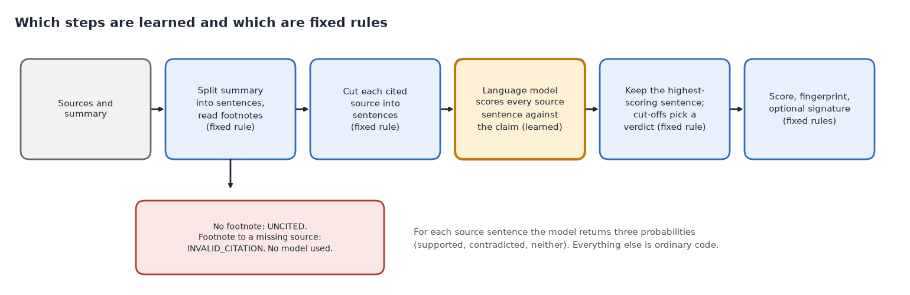
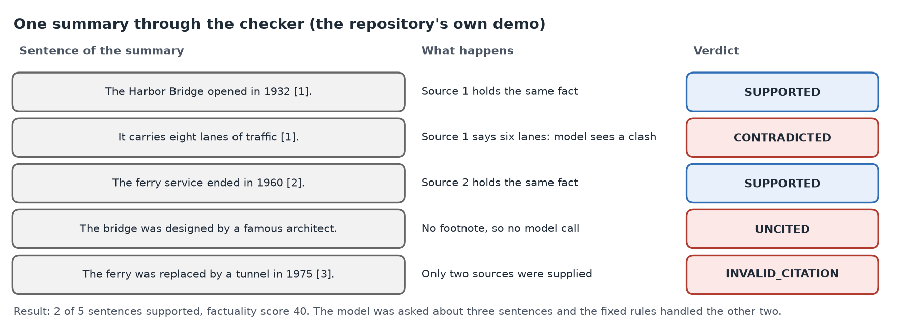
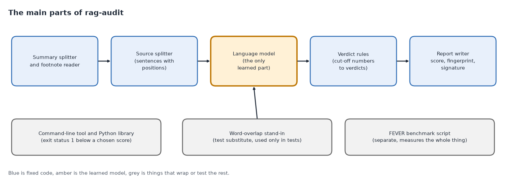
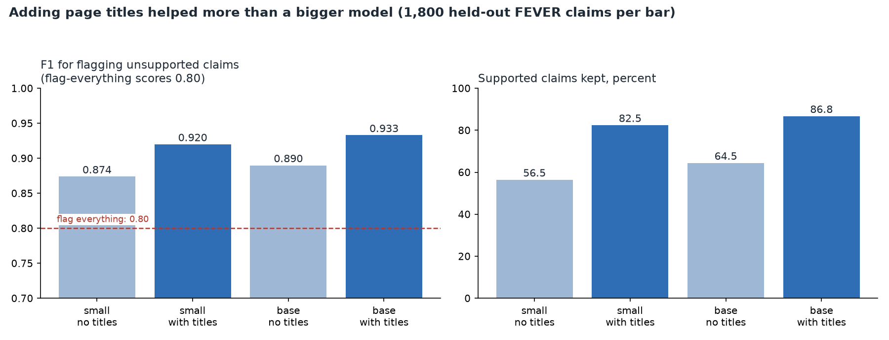

# rag-audit

*A small tool that checks, sentence by sentence, whether the footnotes in an AI-written summary really back up what the sentence says.*

Status: a working library and command-line tool at version 0.2, last changed in October 2026, with a measured benchmark. Code: https://github.com/PCSchmidt/rag-audit (MIT (Massachusetts Institute of Technology) licence, a permissive open-source licence). It is public, has no stars (the bookmarks other people give a project on GitHub), shows no outside users, and has not been released as a package you can install with one command.

AI assistants now write summaries and briefings from documents they are handed, and they decorate the sentences with footnotes such as [1]. A footnote looks like proof. It is not. It is just more text the assistant wrote, so it can sit after a sentence the document never said, point at a document that was never supplied, or follow a sentence with one number quietly changed. Here is the kind of case I mean. A summary says "the port expansion was completed in 2019 [2]", but report 2 says the expansion was planned for 2019 and then delayed. Nobody lied; the assistant wrote something fluent that its source does not say. Most people catch this by skimming, which stops working once there are dozens of summaries a day.

rag-audit does the checking. You give it the source documents and the AI-written summary. It splits the summary into sentences, reads which footnotes each sentence carries, asks a small language model (a program trained on large amounts of text to work with language) one narrow question about each sentence of the cited document, does it back up the claim, say nothing about it, or contradict it, and keeps the best-scoring sentence as the evidence. Fixed rules then turn the answer into one of a few plain verdicts. A claim is supported when its source backs it, contradicted when the source says something different, and unsupported when the source does not back it. A sentence with no footnote is uncited, and a footnote pointing at a document that was not supplied is an invalid citation. Anything that is not supported is flagged for a person to look at, so the port sentence above would be flagged as unsupported. The report also records where in the source the evidence sits, and it carries a fingerprint: a short code worked out from the whole report, like a tamper seal, which changes if the sources, the summary, the model name, the cut-off numbers or any verdict changes.

The one idea that makes it work is a division of labour. A learned model may estimate, but only fixed rules may decide. The README (the project's front-page description) calls this the standalone form of a rule from my other projects: check for made-up claims before anything is published. I chose a small model that classifies sentence pairs over a chatbot judge so the checker is cheap, runs on a laptop without internet, and gives repeatable answers. AI coding agents wrote almost all of the code, and I directed the scope, plan, architecture and preferences. Defense-sector topics interest me, and the tool suits any setting where an AI draft must be checked against its sources.

Here is what is fixed and what is learned. A calculator is deterministic: the same input always gives the same answer. A weather forecast is probabilistic: a best estimate that can be wrong. rag-audit is mostly fixed code with one learned model. The fixed code covers splitting the summary, reading footnotes, cutting sources into sentences, keeping the highest-scoring sentence, comparing against cut-off numbers, computing the score and building the fingerprint, and it gives the same output for the same input. The model's answer is repeatable on one machine (running the repository's demo twice gave the identical fingerprint), but I cannot promise it is identical on other hardware or after a library update, because tiny rounding differences could change digits the fingerprint covers. The model learned from labelled example pairs, so it can be wrong in ways nobody wrote down, and the three numbers it returns are not true probabilities; the project measured them and found they run overconfident. Chance enters in one more place: the benchmark samples claims at random with fixed starting numbers (seeds), so the sample is the same each run, and with 1,800 claims every score carries some noise.

To keep the learned part in check, the project locks in its cut-off numbers on separate data before scoring the test data, flags anything it cannot verify instead of letting it through, keeps the model out of any decision fixed rules can make, and measures against a plain baseline. The output is a list for a person to look at, not a ruling on what is true.



On a public test of Wikipedia claims, the setup I would use (the small model, with the Wikipedia page title added in front of each source sentence) flagged unsupported claims with an F1 score of 0.92. F1 is a single number from 0 to 1 that is high only when a tool both catches most of the bad claims and rarely flags good ones; 1 is perfect. The same setup left unflagged 82.5 percent of the claims that really were supported, which is not overall accuracy but the share of good claims that were not wrongly flagged. The baseline to beat is the do-nothing tool that flags every claim, which scores 0.80. That is a weak baseline, and a tuned method without a language model, which would be a fairer yardstick, was not tested. The gain over it is real but not huge, the test covered one kind of text, and nobody has operated the tool for real users.

If you have ten minutes, read the chapters on what it does, the language model, the results, and the strengths and shortcomings.

## What problem this solves

Anyone who uses AI summaries of documents has the problem described above: analysts, editors, people building products that answer questions from a document collection, and people who evaluate prompts and models. Such a product is called RAG (Retrieval-Augmented Generation): a system looks up documents and has a language model write an answer from them. Today people skim, ask another language model to judge, or do nothing.

The README names four uses: a gate before a RAG answer is shown, a repeatable "does the output stay inside its sources" score for evaluating a model or prompt, a short review list for an analyst or editor, and a checker for people who cannot send documents to a hosted model. The goal is modest and measurable: for a claim cited to a source, say whether the source backs it, and say how well that works on a test where the answers are known. Those numbers exist and are in the results chapter. No measurement exists for long reports, legal or technical text, tables, or anything beyond short Wikipedia-style claims.

Why not just ask another language model whether the summary is faithful? The README's answer is that a model used as a judge is itself a text generator: fluent wording can sway it, it can answer differently from run to run, it costs money on every call, and it tends to share the weaknesses of the model it grades. Here the model only produces three numbers for one source sentence and one claim, and plain code decides. The fair counterpoint is that a chatbot judge can read a whole document and combine facts, which this tool cannot.

What it deliberately does not do: it does not decide whether a claim is true, only whether the cited source supports it, so a false claim that matches a wrong source is marked supported. It does not fetch documents, call a hosted model, or rewrite anything. It is a poor fit for summaries without footnotes, since every sentence is then flagged by design.

In short, the project asks one narrow question, whether the cited source backs this sentence, and answers it with a small, local, testable tool rather than another chatbot.

## Where the project came from

rag-audit began as one item in a roadmap of study projects I had listed, which named a larger set of tools and a wider scope. The README lists the parts that were not built: a release you can install with one command, a second benchmark called HaluEval (a collection of AI answers containing made-up content), and a large model from the plan that I skipped on purpose, explained in the language model chapter.

The README calls the project the standalone form of the rule of checking for fabrication before publishing. In my Hard Power Intelligence project, a defense-and-geopolitics briefing system, a separate reviewing program called an evaluator checks the briefings it writes. In VERA, my research-writing project, an audit looks for unsupported claims in papers. rag-audit pulls the core of that idea into a small library any RAG system could use, and swaps the chatbot judge for the sentence-pair model. It is deliberately narrower than those two: it checks citation support and nothing else.

## What it does, step by step

Here is the repository's own demo, using real output from the real model. Two source documents are supplied. The first says the Harbor Bridge opened to traffic in 1932, carries six lanes of traffic, and is 1,149 metres long. The second says the ferry service ended in 1960 and that ridership fell after the bridge opened. The summary has five sentences:

1. The Harbor Bridge opened in 1932 [1].
2. It carries eight lanes of traffic [1].
3. The ferry service ended in 1960 [2].
4. The bridge was designed by a famous architect.
5. The ferry was replaced by a tunnel in 1975 [3].

The tool splits the summary into these five sentences and notes the footnotes on each. Sentence 4 has none, so it is flagged as uncited with no model involved. Sentence 5 cites document 3, but only two were supplied, so it is flagged as an invalid citation, again with no model. For sentences 1 to 3 the tool cuts each cited document into sentences and asks the model about each source sentence against the claim. The model returns three numbers that add up to one: how likely the source sentence is to entail the claim (logically back it up), be neutral to it, or contradict it. For sentence 1, the best source sentence ("The Harbor Bridge opened to traffic in 1932") got 0.996 for entailment. For sentence 2, the best match was the lanes sentence, which got 0.998 for contradiction, because six is not eight. Sentence 3 got 0.997 for entailment.

The rules then decide. With the demo's cut-off number, sentences 1 and 3 are supported and sentence 2 is contradicted. The factuality score is the supported share of all sentences: two of five, 40 percent. The report lists, for each checked claim, which document and which character positions hold the evidence, and the fingerprint of the whole result closes the report.



The nearest everyday comparison is a copy editor with a stack of source documents and a red pen. The editor reads each sentence of a draft, looks up its footnote, finds the line in the source it points to, marks it backed, contradicted or not backed, and flags any sentence that cites nothing. The analogy breaks because a human editor understands the whole document, combines facts and knows who "he" is in a source sentence, while the tool compares a claim to one source sentence at a time, which turns out to matter a lot.

The tool is used from a short Python call or from a command line that takes the source files and the summary file, prints the report, and signals failure (a non-zero exit status) if the score is below a number you choose. It is automatic from start to finish. The only human step is reading the flagged list afterwards, and nothing forces anyone to do that. Because it runs offline after a one-time download of the model, documents never leave the machine, which suits sensitive settings, though approved handling of the model files and measurement on that setting's own documents would still be needed.

## The parts, the data and the rules

The tool is built from a handful of small parts. The summary splitter and footnote reader cuts the summary into sentences and keeps each one's footnotes and position. The source splitter does the same to each cited source, keeping positions so evidence can be traced back. The language model scores a source sentence against a claim. The verdict rules turn scores into verdicts, and the report writer computes the score, builds the fingerprint and, if you supply a secret key, signs it. A command-line wrapper sits around these, and a crude word-counting substitute for the model is used only in tests.



The rules the tool should never break are about the honesty of the report. A claim with no footnote is never marked supported. A footnote outside the supplied sources is never silently ignored. The model's three numbers must add up to one, and the code refuses numbers that do not. Every checked claim carries the document number and character positions of its evidence, and the tests confirm they match the source text. The fingerprint changes if any source, the summary, the model name, the cut-off numbers or any verdict changes. Bad-input probes found these rules held, apart from the few weak spots described in the testing chapter.

The data is public. The benchmark uses FEVER (Fact Extraction and VERification), a research collection of short claims written about Wikipedia. People labelled each claim as supported, refuted (the evidence contradicts it) or not enough information, and attached the evidence sentences. The project uses a copy hosted on Hugging Face, a site where datasets and models are shared. A claim is treated as a one-sentence summary cited to its evidence, and the tool should keep supported claims and flag the other two kinds. FEVER's text carries share-alike licence terms (anything built from it must be shared under the same terms), so the project strips the claim and Wikipedia text from the files it saves, keeping only identifiers, labels and scores, and the benchmark script fetches the text again from the identifiers. No private data is used, and no keys are needed.

The weakest link is the match between FEVER and real use. FEVER hands over a few evidence sentences per claim. A real summary cites whole documents with many sentences, and the tool picks the best-matching one, which gives more chances for an unrelated sentence to match by accident. The project does not measure that.

Everything is held in memory during a run, and nothing persists but the report you save and the benchmark's result files. Running twice on the same input gives the same report on the same machine. If the model cannot be loaded the tool stops with an error, so nothing is passed unverified. The main package is about four hundred lines of Python, and a Docker recipe (a file describing how to package the tool so it runs the same elsewhere) runs the tests, without the model. If the work grew a hundredfold, the first thing to slow would be the model, which runs on every source sentence in turn on a single ordinary processor. Long documents were not timed.

## The methods and the arithmetic

The methods are few, and each is small enough to check by hand.

Splitting a summary into claims uses a text pattern: a sentence ends at a full stop, question mark or exclamation mark followed by a space and a capital letter or digit, and footnote markers right after the full stop stay with their sentence. This is the project's most fragile spot. The first benchmark run was thrown away because a footnote after the full stop ("The bridge opened in 1932. [1]") was cut into a claim and a lone footnote, so every claim looked uncited. It is fixed and has its own test.

To find the best evidence, the tool cuts the cited source into sentences, asks the model about each against the claim, and keeps the one with the highest entailment number. If a claim cites two sources, the best across both is kept.

The decision rule uses two thresholds, meaning cut-off numbers. A claim is supported when the best entailment is at or above the first threshold. If not, and some cited sentence has a contradiction number at or above the second threshold, the verdict is contradicted. Otherwise it is unsupported. Toy example, using the demo's first threshold of 0.55 and the default second threshold of 0.5: a best entailment of 0.996 is supported. For the lanes claim, entailment is 0.0 and contradiction 0.998, so the verdict is contradicted. A claim scoring 0.40 entailment and 0.10 contradiction would be unsupported: flagged, but not called wrong. The factuality score is supported claims divided by all claims, times 100; two of five gives 40.

The fingerprint is a SHA-256 hash (Secure Hash Algorithm, 256-bit), a way of turning any text into a short fixed-length code such that a one-character change gives a completely different code. The tool hashes each source and the summary, then hashes a record of the model name, the two thresholds, and each claim's text, verdict, rounded entailment and evidence position. An HMAC (Hash-based Message Authentication Code) adds a signature that only someone holding the same secret key can recreate. Two limits: without a key the fingerprint only detects accidental change, since anyone can recompute it after editing; and a shared-key signature cannot prove to an outsider who signed. It also records the model's name but not its exact version.

Judging the benchmark takes three measures. A flagged claim counts as a positive: a true positive (TP) is a bad claim correctly flagged, a false positive (FP) is a good claim wrongly flagged, and a false negative (FN) is a bad claim missed. Precision is, of the claims flagged, the share that really were bad. Recall is, of the really bad claims, the share flagged. F1 is high only if both are high. Worked example from the results: the test has 600 claims of each of three labels, so 1,200 should be flagged and 600 kept. The setup I would use flagged about 1,112 of the 1,200 (recall 0.927) and wrongly flagged 105 of the 600 good ones. Of about 1,217 flagged, 1,112 were right: precision 0.914. A tool that flags everything has recall 1.0 and precision 0.667 (1,200 of 1,800), so F1 of 0.80. That is the baseline to beat, and it keeps nothing, which is why the project also reports the share of supported claims kept. Flag-everything keeps 0 percent.

The formula, if you want it: precision = TP / (TP + FP); recall = TP / (TP + FN); F1 = 2 x precision x recall / (precision + recall).

Thresholds are chosen on separate tuning data (the project calls it development data). The script tries cut-offs from 0.05 to 0.95, picks the best F1 on about 1,790 tuning claims, and locks it in before the test set is scored. The chosen thresholds across the four setups range from 0.15 to 0.60, so none is a true optimum, and the README says so.

Calibration asks whether a number means what it says: if the model gives 0.9 on a hundred claims, about ninety should be truly supported. ECE (Expected Calibration Error) sorts claims into ten groups by the model's number, compares each group's average number with the share actually supported, and averages the gaps weighted by group size. Zero is perfect. The project got 0.08 to 0.17, meaning the numbers run overconfident, and it advises against presenting the raw entailment number as a probability.

## The language model and what it does

The measured system uses one kind of learned model, in two sizes, and no chatbot anywhere. There is no prompt, no hosted model and no agent. The learned part does NLI (Natural Language Inference), the old task of taking two short texts, a premise and a hypothesis, and saying whether the premise entails the hypothesis, is neutral to it, or contradicts it. Here the premise is one source sentence and the hypothesis is the claim.

The main model is nli-deberta-v3-small, published on Hugging Face under the full name cross-encoder/nli-deberta-v3-small. DeBERTa (Decoding-enhanced BERT with disentangled attention) is a family of language models from Microsoft; this is the small version, fine-tuned (given extra training) for NLI. It is a cross-encoder, meaning it reads both texts together in one pass instead of summarising each as a list of numbers and comparing the lists. That is slower but usually better at judging how two texts relate. It takes in a source sentence and a claim and gives back three probabilities that sum to one. In everyday terms it learned from many sentence pairs that people had labelled, rewarded for matching their labels; the repository does not record which collection.

The README's reasons for choosing it are practical: it is small (about 570 megabytes), runs on an ordinary processor with no graphics card, costs nothing per use, and keeps documents on the machine after the first download. No head-to-head against other models of its size is documented, so it is a reasonable choice, not a proven best. The code reads the model's label order from its own settings and refuses to run if the labels are not the expected three.

The comparison model is nli-deberta-v3-base, the same family one size up (about 740 megabytes), used to ask whether a bigger model fixes the problem. It roughly doubles the time per claim and gains a little, as the results chapter shows. A third model, roberta-large-snli_mnli_fever_anli, was named in my plan and skipped on purpose. It was trained on FEVER itself, so testing it on FEVER would be like grading a student on questions they had already seen. The README records the skip as a known gap.

A small stand-in class guesses entailment from the share of the claim's words found in the source sentence. It is not a model of truth, and the code says never to report its numbers as verification quality. It exists so the logic can be tested without downloading the model. In a scratch check for this guide on the test sample, it reached F1 about 0.81 but kept only about one good claim in ten, so it is close to flag-everything.

What goes wrong with the model, from the project's findings and a few small probes: it sees one source sentence at a time, so "He was born in 1950" does not tell it who "he" is. A claim needing two source sentences combined was marked unsupported in a probe, and the README says it may be. A sentence holding two facts gets one verdict, so a claim whose two halves are both true was flagged in a probe. It cuts any pair at 512 tokens (word-pieces, roughly three-quarters of a word each). Negated and number-changed claims came back contradicted in a handful of probes, which is encouraging but not a measurement; paraphrased, negated or misleading claims were not systematically tested.

The safeguards around the model are the fixed parts. Cut-off numbers are locked in on separate data. Anything uncited, mis-cited or not backed is flagged, so the failure direction is to ask a person to look. The model takes no instructions, so there are no prompts to version. The project pins no model version, so if the publisher changed or removed the model, a fresh install would fail or fetch something different.

In short, a small, local sentence-pair model supplies three numbers per comparison, and every decision built on them is fixed code a person can read.

## Testing, edge cases and safeguards

There are ten automatic tests. Most check one small piece of the logic, like testing one gear at a time. A few check bigger promises: that every verdict can be reached, that evidence positions point at the right text, that the fingerprint is stable and changes when an input changes, and that a signature verifies with the right key and fails with a wrong one. Three feed in hundreds of random inputs and check a rule always holds, for example that the score stays between 0 and 100. One was added to lock in the footnote fix. All ten pass, as do the type checker and style checker. What these tests prove is that the plain code does what it says. What they do not prove is that the real model judges well, because the tests use the word-counting stand-in or a scripted model that returns chosen numbers, never the real one. The benchmark covers the real model instead. The project's automatic checks on each change run the ten tests and the type checker, but not the style checker the README lists, the benchmark or the real model.

Bad-input probes run for this guide showed mostly sensible behaviour. A footnote numbered 0, or beyond the sources, is flagged as an invalid citation. An empty source document leaves the claim unsupported without a crash. A cut-off outside 0 to 1 is refused with a clear error. The weak spots are in the splitter: a sentence starting with a lowercase letter is not split from the one before it, and "Dr." followed by a capital letter becomes its own uncited claim and lowers the score. The full list of probes is in the appendix.

The evaluation plan was written before the results: the first commit's results file described the locked-in design and said no benchmark had run, and the benchmark script arrived about twenty minutes later. That is a plan, not a locked protocol with a stated success rule, so I would not lean on it as proof of rigour. The script does enforce one rule in code: it refuses to run the test set a second time for the same setup. The first test run was invalid because of the footnote bug: every claim looked uncited, so none was counted as supported, which made the tool look perfect at catching bad claims and useless at keeping good ones. The project kept the invalid files, fixed the bug, added a regression test and drew a new test sample. That run exposed no model scores, so the locked-in cut-offs were not influenced.

## Does it work? The results

The benchmark asks one thing: given a claim cited to its FEVER evidence, does the tool keep the supported claims and flag the rest? There were 600 claims for each of three labels, 1,800 in all, from FEVER's test split. Cut-offs were locked in on the tuning split first, one per setup, and each setup ran once on the test claims.

The project ran a two-by-two experiment: small model against base model, with and without the Wikipedia page title placed in front of each evidence sentence ("Harbor Bridge: It opened in 1932" rather than "It opened in 1932"). The title idea came from a failure. An earlier run of the small model without titles kept only about half of the supported claims. A guess that multi-sentence evidence was the cause was tested and rejected: single-sentence and multi-sentence cases were kept at the same rate, about 52 percent. The real cause was missing context. Many evidence sentences begin with "He" or "It", and the model cannot know who that is.



Note that the F1 chart's vertical axis starts at 0.70, which makes the gaps look larger than they are.

The numbers behind the chart, with F1 first and the share of supported claims kept second. The small model without titles scored 0.874 and kept 56.5 percent. The small model with titles scored 0.920 and kept 82.5 percent. The base model without titles scored 0.890 and kept 64.5 percent. The base model with titles scored 0.933 and kept 86.8 percent. Flagging everything scored 0.800 and kept 0. The catch rate for really unsupported claims stayed between 93 and 95 percent in every setup, so the setups differ mainly in how many good claims they wrongly flag.

How to read this. Flagging everything scores 0.80, so the plainest setup beats it by 0.07 and the best by about 0.13. The more telling measure is supported claims kept. Without titles the small model wrongly flagged almost half the good claims, which would make a person stop trusting it. Titles lifted that to 82.5 percent at no time cost. Going from small to base without titles gained 8 points, a third of what titles gave, at double the time. The base model with titles scored highest, 0.933, at about 95 thousandths of a second, but its F1 gap over the small model with titles, 0.013, is within the noise the README estimates for a test this size, about 1.5 to 2 points; the gap between titles and no titles is not. So I name the small model with titles as the setup to use, as the best balance of quality and cost, while the base model with titles is nominally the top score.

About 83 percent of claims labelled refuted came back with the more informative contradicted verdict. The raw entailment number is overconfident, with calibration error 0.09 with titles and 0.17 without for the small model, so it should not be shown as "92% sure".

The four setups use the same claims and procedure, but the title idea came from looking at an earlier test sample, though the final numbers use a fresh sample. The flag-everything baseline is mine, not the project's, and a tuned non-model method would be a stronger yardstick that the project does not include. The README's numbers match the saved result files.

In short, with page titles the small model catches about 93 percent of unsupported claims while keeping about 82 percent of good ones, which beats doing nothing but is shown on one kind of text.

## Could it be put into real use?

It has never run for real users. It has run on a development laptop and in an automatic check service, and nothing is hosted; the only public things are the code and its results. On a ladder running from experiment, to works locally, to deployable, to operated, it sits at works locally. The library, command line and container recipe exist, but it would need real work before anyone could depend on it.

Against the usual production habits the picture is mixed. A newcomer could run it from the README, though versions are not locked. Automatic checks block a change that breaks the tests or type checker, but none runs the benchmark or the real model, so a quality drop would not stop a release. Quality is measured against a baseline, on one dataset. The tool prints a report and nothing else, so there are no logs for diagnosing failures or watching quality. Data is public and the only secret is an optional signing key.

To run it for real users it would need a release, a service wrapper with sign-in, logs and quality alerts, locked model and library versions, a plan for the cost of running a 570-megabyte model per request, and measurement on the users' own documents. As a showcase it is a reasonable one: small and honest about its limits, though a hosted demo adds little unless it is measured on realistic documents.

## Strengths, shortcomings and the work still to do

The strongest thing about the project is how it treats its own numbers. The split between model and fixed rules is clean, so output is auditable and the report states where its evidence is. Cut-offs were locked in before testing. A failure became a finding: false flags led to the page-title discovery, and the invalid run stayed in the record.

The shortcomings are of three kinds. The defects are small. The command line cannot set cut-offs or add titles, so a user gets a default of 0.7 the benchmark never ran, though the tuning curve is nearly flat there (0.927 against 0.928 for the small model with titles), so the cost is probably small. The splitter mishandles abbreviations and lowercase starts. The README lists a style check the automatic checks do not run, and a few result logs still contain a local folder path although the project says it scrubbed them.

The gaps are bigger. The tool compares a claim to one source sentence at a time, so claims needing two facts, or two documents, are flagged. It is measured only on FEVER, whose tidy evidence bundle flatters the tool relative to full documents. Adversarial wording is untested. The model version is not pinned and its training collection is not recorded. The deliberate limits are stated: it checks support, not truth; it does not fetch or rewrite; and context is the caller's job. That last one bites hardest, because the biggest measured gain depends on a step the library leaves to the user.

If I continued, I would do three things. Expose cut-offs and title context in the command line and library, which is small and closes the main gap between what was measured and what a user gets. Run the benchmark on a second kind of text, even a small hand-labelled sample of real briefings. And try a step that resolves "he" and "it" to names, or includes the previous sentence, and test whether it beats page titles. It is free to run on a laptop and needs Python 3.11 or later. The main risk is over-trust: a high score may be read as "this summary is true", which the README says it is not.

In short, the project is honest and sound within a narrow lane, and the best next steps are closing the gap between what was measured and what the command line does, and testing a second kind of text.

## How it was built, and who did what

AI coding agents wrote almost all of the code, and I directed the scope, plan, architecture and preferences. I did not write the code by hand, and I do not claim to have. The commits carry a credit line for Claude Sonnet 5.5 on eleven of twelve commits and for Claude Opus 5.5 on the last, a documentation commit. The repository has no agent instruction files, so those credits are the whole record of tools.

The decisions the documents record as mine: the scope as a citation-support checker only, with the model confined to producing numbers and fixed code deciding; a small local model over a hosted judge; an evaluation with locked-in cut-offs written down before running; skipping the large model that trained on FEVER; keeping the invalid run in the record; and listing unbuilt roadmap parts as known gaps.

The history shows the build correcting itself over about ten days in October 2026: a scaffold with honest "no results yet" notes, the benchmark and the footnote bug found through an absurd result, the titles experiment, a clean-up that removed licensed text and a local username from saved files, and a final listing of roadmap gaps. How I personally reviewed the agents' changes is not recorded.

## For recruiters and interviewers

In thirty seconds: rag-audit is a small, local tool that checks whether each sentence of an AI-written summary is backed by the document its footnote cites. A small sentence-pair model gives three numbers, and fixed rules decide and seal the result. On a Wikipedia benchmark the setup I would use flags unsupported claims at F1 0.92 while keeping about 82 percent of good ones, against 0.80 for flagging everything.

In two minutes, add the evaluation story: an invalid first run kept in view, false flags traced to missing context, and page titles helping more than a bigger model. Then say what it is not: measured on one kind of text, not hosted, no users.

What it demonstrates: a clean split between a probabilistic model and fixed rules; honest evaluation with locked-in cut-offs, a baseline and an invalid run left visible; small, typed library design; and directing AI coding agents. It does not demonstrate operating anything for users, teamwork, scale, or building from scratch live.

| Typical requirement | What the project shows | How to say it honestly |
| --- | --- | --- |
| Measuring AI output quality | Held-out test, baseline, calibration; one dataset | "I measured on 1,800 held-out claims and reported what failed." |
| Human-in-the-loop controls | Flagged list with located evidence; partly | "It makes the review list; it does not enforce review." |
| Choosing a model and trade-offs | Two sizes compared, one skipped; partly | "I compared two sizes of one family on cost and quality." |
| RAG patterns | Checks the output side, no retrieval; partly | "It audits answers; it does not build retrieval." |
| Deploying and monitoring | Container recipe only; simulated | "I have not run this for users." |
| Agent workflows (AI programs acting in steps) | None | "This uses no agents or chat model." |

The closest role family is an applied language-model engineer with an evaluation focus, meaning someone who puts an existing model to work and measures it, since this applies an existing model with fixed checks around it, though without agent or prompt work. The weakest fit is machine-learning engineer with deployment duties, since nothing was trained or operated.

Four likely questions.

1. *A decision that turned out wrong?* A first test run looked perfect because a bug made every claim look uncited. The result was too good to be true, so it was investigated, kept in the record, fixed and re-run on a new sample.
2. *How do you know it works?* Held-out claims, locked-in cut-offs and a baseline, but one dataset, so I would not claim more.
3. *How did you use AI tools without losing quality control?* Agents wrote the code while the design rules, tests and evaluation plan set the standard, and the history shows the checks catching a real bug.
4. *How would you put it into production?* Expose the cut-offs, pin the model, run the benchmark on every change, measure on real documents, then wrap it in a service with logs.

Three tough ones. *Isn't it a wrapper around someone else's model?* Partly: the model is borrowed, while the splitting, evidence tracing, rules, fingerprint and evaluation are the project's. *If agents wrote the code, what did you do?* Directed the scope and design and judged the results. *Why believe the numbers?* They match the saved result files, but it is one dataset and one run per setup.

In short, the project shows careful evaluation and a clean model-versus-rules design, and it does not show production operation.

## Glossary

- **Baseline:** a simple do-nothing or plain method that a tool must beat; here, flagging every claim.
- **Calibration:** whether a number such as 0.9 turns out right about ninety percent of the time.
- **Cross-encoder:** a model that reads two texts together to judge how they relate.
- **DeBERTa (Decoding-enhanced BERT with disentangled attention):** a family of language models; the project uses its small and base sizes.
- **ECE (Expected Calibration Error):** the average gap between a model's stated confidence and how often it is right; zero is perfect.
- **Entailment:** one text logically backing up another.
- **FEVER (Fact Extraction and VERification):** a research collection of claims about Wikipedia labelled supported, refuted or not enough information.
- **F1:** one score from 0 to 1 combining precision and recall.
- **Fingerprint:** a short code computed from a whole report that changes if anything in it changes.
- **Held-out:** data kept aside and not used to tune anything, so it tests fairly.
- **HMAC (Hash-based Message Authentication Code):** a signature made with a secret key.
- **NLI (Natural Language Inference):** judging whether one text entails, is neutral to, or contradicts another.
- **Precision and recall:** of the claims flagged, the share truly bad; of the truly bad claims, the share flagged.
- **RAG (Retrieval-Augmented Generation):** a system that looks up documents and has a language model write an answer from them.
- **SHA-256 (Secure Hash Algorithm, 256-bit):** a way of turning text into a short code that changes completely if the text changes.
- **Threshold:** a cut-off number that turns a score into a decision.

## Appendix: the bad-input probes

These come from probes run in a scratch copy for this guide, using the word-counting stand-in unless noted.

| Situation | What happens | Handled well? |
| --- | --- | --- |
| Empty summary | Score 0 with no claims | Reasonable, though a gate set to fail below a score would fail it |
| Footnote 0, or beyond the sources | Flagged as an invalid citation | Yes |
| One valid and one invalid footnote on a claim | The whole claim is flagged invalid | Cautious, and arguably right |
| An empty source document | Claim flagged unsupported, no crash | Yes |
| Cut-off outside 0 to 1 | Refused with a clear error | Yes |
| A sentence starting with a lowercase letter | Not split from the previous sentence | Weak: two sentences become one claim |
| "Dr." followed by a capital letter | "Dr." becomes its own uncited claim and lowers the score | Weak |
| A sentence with two facts, both true | One verdict; flagged unsupported in a probe | Known limit |
| Source text saying "ignore previous instructions" | Ignored, since the model takes no instructions | Yes, in the one probe |
| Report checked with a wrong key, or unsigned | Verification returns false | Yes |

No test attacks a crash halfway through, but there is nothing to leave half-done.

## Where to look in the code

This list is for engineers; other readers can stop here.

```
rag-audit/
  src/rag_audit/   the library: claims.py (splitting), auditor.py (best evidence, verdicts, hash), nli.py (models and stand-in), cli.py
  tests/           ten tests, including random-input ones
  scripts/         the FEVER benchmark and the script that runs the two-by-two experiment
  examples/        demo.py, the worked example
  results/         locked-in cut-offs and per-claim scores behind every number
  docs/            RESULTS.md, the protocol and findings
```

In a scratch copy the tests, type checker and style checker passed and the demo reproduced the README output and fingerprint. Five files to read first: auditor.py, claims.py, nli.py, docs/RESULTS.md and scripts/fever_benchmark.py.
